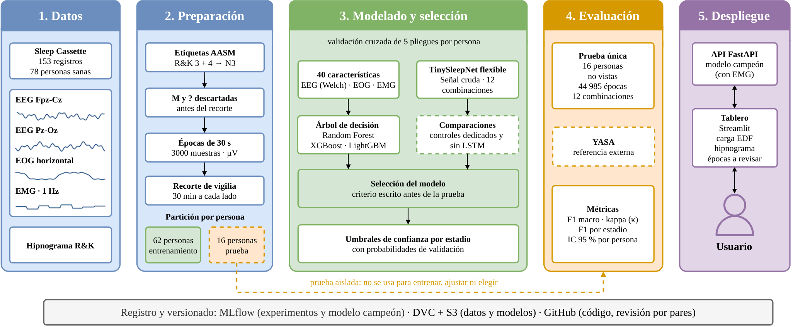
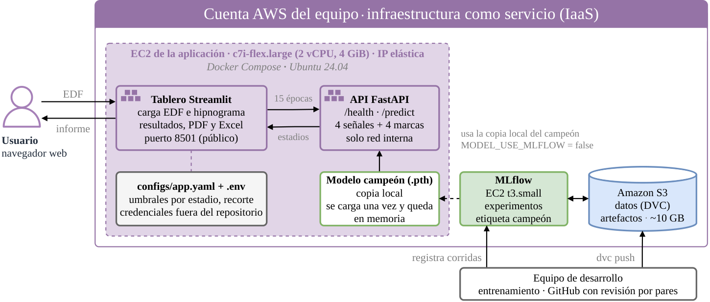
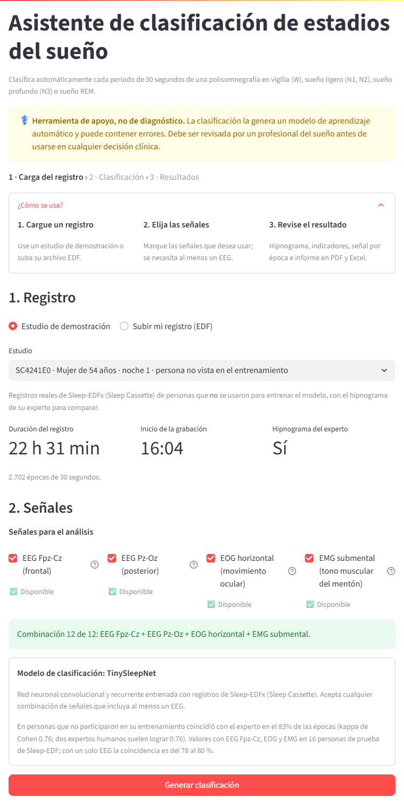
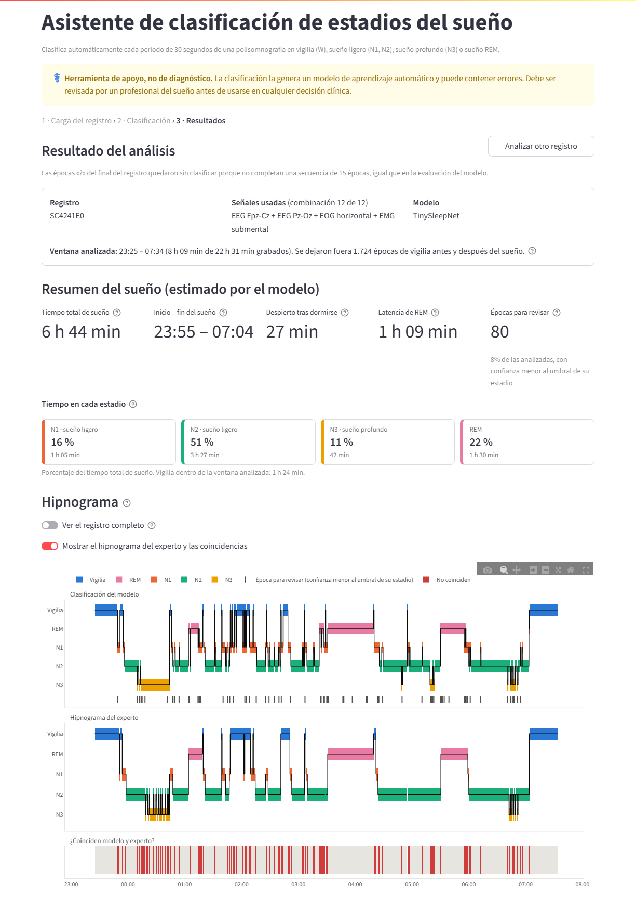

# Clasificación automática de estadios del sueño

Sistema de apoyo a la revisión de polisomnografías: clasifica cada época de 30 segundos en un estadio del sueño, dibuja el hipnograma y señala las épocas en las que el modelo tiene baja confianza para que el técnico concentre allí su revisión. Funciona con cualquier combinación de señales que incluya al menos un canal de EEG.

Proyecto de grado de la Maestría en Inteligencia Artificial (Universidad de los Andes), sobre una propuesta del Grupo de Ingeniería Biomédica (IBIO).

> **Uso previsto.** Es una herramienta de apoyo a la revisión, no de diagnóstico. Toda predicción debe ser validada por personal entrenado.

## Contenido

1. [Problema y solución](#1-problema-y-solución)
2. [Enlaces](#2-enlaces)
3. [Arquitectura](#3-arquitectura)
4. [Instrucciones de uso](#4-instrucciones-de-uso)
5. [Ejemplos de entrada y salida](#5-ejemplos-de-entrada-y-salida)
6. [Modelos: tamaño, hardware y tiempos de inferencia](#6-modelos-tamaño-hardware-y-tiempos-de-inferencia)
7. [Dependencias y entorno](#7-dependencias-y-entorno)
8. [Ejecutar en local](#8-ejecutar-en-local)
9. [Reproducir el despliegue](#9-reproducir-el-despliegue)
10. [Reproducir el entrenamiento](#10-reproducir-el-entrenamiento)
11. [Parámetros configurables](#11-parámetros-configurables)
12. [Credenciales de ejemplo](#12-credenciales-de-ejemplo)
13. [Estructura del repositorio](#13-estructura-del-repositorio)
14. [Equipo](#14-equipo)

## 1. Problema y solución

**Problema.** La estadificación del sueño se hace a mano, época por época: una noche tiene entre 800 y 1200 épocas de 30 s. Es lenta y variable: dos expertos coinciden en cerca del 82.6 % de las épocas, y en el estadio N1 apenas en el 63 % (Rosenberg y Van Hout, 2013).

**Solución.** Un modelo de aprendizaje de máquina asigna a cada época uno de cinco estadios, y una aplicación web muestra el resultado y las épocas que conviene revisar.



**Alcance.**

| Aspecto | Decisión |
|---|---|
| Clases | 5: vigilia (W), N1, N2, N3 y REM. Las etapas 3 y 4 de Rechtschaffen y Kales se unen en N3 (criterio AASM). Las épocas de movimiento (M) y las sin clasificar ("?") se excluyen del entrenamiento del clasificador |
| Datos | Subconjunto Sleep Cassette de [Sleep-EDF Expanded](https://physionet.org/content/sleep-edfx/1.0.0/): 153 registros de 78 personas sanas |
| Señales | Al menos un EEG (Fpz-Cz, Pz-Oz o ambos), con EOG y EMG opcionales: 12 combinaciones |
| Evaluación | Partición por persona (ninguna persona aparece en entrenamiento y prueba) y comparación con el acuerdo entre expertos humanos |

## 2. Enlaces

| Recurso | Enlace |
|---|---|
| Aplicación (tablero) | http://18.223.227.20:8501 (IP elástica en AWS EC2; no requiere usuario ni contraseña; la instancia permanece encendida durante el periodo de evaluación) |
| API y documentación interactiva | La API no se publica a Internet: solo la usa el tablero dentro de la instancia. Su documentación interactiva (Swagger) queda en http://localhost:8000/docs al ejecutar el proyecto en local (sección 8) |
| Conjunto de datos | [Sleep-EDF Expanded en PhysioNet](https://physionet.org/content/sleep-edfx/1.0.0/) |
| Manual de usuario del tablero | [app/dashboard/manuales/Manual_Usuario_Tablero.md](app/dashboard/manuales/Manual_Usuario_Tablero.md) |
| Guía de despliegue del tablero | [app/dashboard/manuales/Guia_Despliegue_Tablero.md](app/dashboard/manuales/Guia_Despliegue_Tablero.md) |

> La aplicación se sirve por HTTP, sin cifrado; algunos navegadores muestran el aviso «No seguro». Es esperado: la aplicación no pide usuario, contraseña ni datos personales.

## 3. Arquitectura



El usuario solo accede al tablero (puerto 8501). La API no se publica a Internet: el tablero la llama por la red interna de Docker. La API usa una copia local del modelo campeón ([`modelos/flexible_emg_mlp_final.pth`](modelos)): la carga la primera vez que clasifica y la mantiene en memoria. Con `MODEL_USE_MLFLOW=false`, la configuración de la versión desplegada, la predicción no depende de que MLflow esté encendido; con `true`, la API consulta en MLflow el campeón vigente en cada solicitud y actualiza la copia si cambió.

| Componente | Tecnología | Función |
|---|---|---|
| Tablero | Streamlit | Selección del estudio y de las señales; hipnograma, distribución de estadios y revisión por época |
| API | FastAPI | Recibe las épocas y las señales disponibles y devuelve, por época, el estadio predicho, la confianza y las probabilidades |
| Modelo | PyTorch: TinySleepNet flexible con rama EMG | Un solo modelo para las 12 combinaciones de señales; la API carga el campeón marcado en MLflow (`champion=true`) desde una copia local |
| Contenedores | Docker y Docker Compose | Un servicio para la API y otro para el tablero |
| Nube | AWS EC2 c7i-flex.large (2 vCPU, 4 GiB de RAM, Ubuntu Server 24.04, disco de 30 GB) en us-east-2 (Ohio), con IP elástica | Aloja los dos contenedores; solo el puerto 8501 está abierto a Internet |
| Experimentos y datos | MLflow (en una instancia EC2 t3.small aparte) y DVC sobre Amazon S3 | Registro de experimentos, versionado de datos y almacenamiento de los modelos |

## 4. Instrucciones de uso

1. Abrir el tablero (sección 2).
2. **Carga:** elegir un estudio de demostración o subir un EDF propio (el hipnograma del experto es opcional) y marcar las señales disponibles. Se necesita al menos un EEG; con EOG y EMG opcionales hay 12 combinaciones.
3. Pulsar **Generar clasificación**. Una barra muestra el avance; en la versión desplegada, una noche de Sleep Cassette tardó entre 35 y 38 segundos con las cuatro señales.
4. **Resultados:** ventana analizada; indicadores (tiempo total de sueño, inicio y fin del sueño, despierto tras dormirse, latencia de REM y épocas para revisar); tiempo en cada estadio; hipnograma; visor de la señal por época con la confianza y la segunda opción del modelo; comparación con el experto, si se cargó su hipnograma; y descarga del informe en PDF y de los datos por época en Excel.

El [manual de usuario](app/dashboard/manuales/Manual_Usuario_Tablero.md) explica cada elemento de la pantalla.

| Carga del registro | Resultados |
|---|---|
|  |  |

## 5. Ejemplos de entrada y salida

### Tablero

**Entrada:** un registro de polisomnografía en formato EDF (`*-PSG.edf`) y, de forma opcional, el hipnograma del experto (`*-Hypnogram.edf`), o uno de los cuatro estudios de demostración. El usuario marca las señales disponibles (al menos un EEG).

**Salida:** la pantalla de resultados (sección 4) y dos archivos descargables. En [`reports/ejemplos/`](reports/ejemplos) hay una salida real del tablero desplegado para el estudio de demostración SC4241E0:

| Archivo | Contenido |
|---|---|
| [`informe_sueno_SC4241E0.pdf`](reports/ejemplos/informe_sueno_SC4241E0.pdf) | Informe con los hallazgos en lenguaje sencillo, los indicadores del sueño, el hipnograma, el tiempo en cada estadio, la comparación con el experto y la lista de épocas para revisar |
| [`clasificacion_SC4241E0.xlsx`](reports/ejemplos/clasificacion_SC4241E0.xlsx) | Una fila por época: hora, estadio del modelo, confianza, si conviene revisarla, probabilidad de cada estadio, estadio del experto y si coinciden; más una hoja con las épocas para revisar y otra que explica cada columna |

### API

El tablero llama a `POST /predict-tinysleepnet` con bloques de secuencias de 15 épocas. Cada época tiene 3000 muestras (30 s a 100 Hz) por canal, en microvoltios, en un orden fijo de 8 canales: las cuatro señales y una marca de presencia (0 o 1) por cada una. Una señal ausente se envía en ceros con su marca en 0; el EMG, que en Sleep-EDF viene a 1 Hz, se repite 100 veces por muestra.

**Entrada** (los arreglos se recortan aquí; `epochs` tiene forma `(secuencias, 15, 8, 3000)`, con 1 a 4 secuencias por solicitud):

```json
{
  "channel_names": ["EEG Fpz-Cz", "EEG Pz-Oz", "EOG horizontal", "EMG submental",
                    "presence EEG Fpz-Cz", "presence EEG Pz-Oz",
                    "presence EOG horizontal", "presence EMG submental"],
  "sampling_rate_hz": 100,
  "signal_unit": "uV",
  "epochs": [[[[12.4, 10.9, "... 3000 muestras de EEG Fpz-Cz ..."],
               ["... EEG Pz-Oz ..."], ["... EOG horizontal ..."], ["... EMG submental ..."],
               [1.0, 1.0, "..."], [1.0, 1.0, "..."], [1.0, 1.0, "..."], [1.0, 1.0, "..."]],
              "... 15 épocas por secuencia ..."]]
}
```

**Salida** (las dos primeras épocas de una respuesta real para SC4241E0, con valores redondeados):

```json
{
  "model_name": "modelo_final/flexible_emg_mlp_final.pth",
  "channel": "TinySleepNetEMG-8-canales",
  "sampling_rate_hz": 100,
  "predictions": [
    {"epoch_index": 0, "predicted_stage": "W", "confidence": 0.9976,
     "probabilities": {"W": 0.9976, "N1": 0.0018, "N2": 0.0003, "N3": 0.0001, "REM": 0.0003}},
    {"epoch_index": 1, "predicted_stage": "W", "confidence": 0.9995,
     "probabilities": {"W": 0.9995, "N1": 0.0004, "N2": 0.0000, "N3": 0.0000, "REM": 0.0000}}
  ]
}
```

La API valida la entrada y responde con un error 422 y un mensaje claro si los canales no están en el orden fijo, si falta un EEG, si una señal marcada como ausente no viene en ceros o si una secuencia no tiene 15 épocas. `GET /health` informa el modelo cargado y su `run_id` de MLflow.

## 6. Modelos: tamaño, hardware y tiempos de inferencia

### Desempeño en prueba

16 personas que no participaron en el entrenamiento ni en la selección del modelo (44 985 épocas, las mismas para todos los modelos), 5 clases. Entre corchetes, intervalo de confianza del 95 % por remuestreo de personas. La tabla completa por combinación está en el artículo.

| Modelo | Señales | Exactitud | F1 macro | Kappa |
|---|---|---|---|---|
| TinySleepNet flexible con EMG (campeón, desplegado) | Fpz-Cz + EOG + EMG | 0.826 | 0.784 [0.756–0.809] | 0.762 |
| TinySleepNet flexible con EMG (campeón, desplegado) | Las cuatro señales | 0.827 | 0.784 [0.756–0.808] | 0.764 |
| TinySleepNet flexible con EMG (campeón, desplegado) | Fpz-Cz | 0.799 | 0.749 [0.717–0.778] | 0.726 |
| TinySleepNet flexible con EMG (campeón, desplegado) | Promedio de las 12 combinaciones | 0.807 | 0.758 | 0.736 |
| XGBoost (mejor modelo clásico) | Las cuatro señales | – | 0.734 | 0.702 |
| XGBoost | Fpz-Cz + EOG + EMG | – | 0.712 | 0.675 |
| XGBoost | Fpz-Cz | – | 0.616 | 0.564 |
| YASA (referencia externa preentrenada) | Fpz-Cz + EOG | – | 0.695 | 0.715 |

Con los umbrales de confianza por estadio del tablero (fijados en la validación cruzada), el 11.9 % de las épocas queda marcado para revisión y la exactitud de las aceptadas sube de 0.807 a 0.861.

### Tamaño y hardware

| Elemento | Valor |
|---|---|
| Parámetros del campeón | 1 558 165 (la versión base de TinySleepNet tiene 1 516 421; la diferencia son los canales de entrada adicionales y la rama del EMG) |
| Archivo del modelo | 6 MB ([`modelos/flexible_emg_mlp_final.pth`](modelos)) |
| Hardware de inferencia | CPU, sin GPU |
| Instancia | AWS EC2 c7i-flex.large: 2 vCPU, 4 GiB de RAM |
| Imagen de Docker de la API | 3.1 GB en disco (795 MB comprimida); incluye PyTorch para CPU |
| Imagen de Docker del tablero | 1.7 GB en disco (504 MB comprimida); no incluye PyTorch |
| Memoria en uso (`docker stats`) | API 745 MiB y tablero 1.1 GiB, de 3.7 GiB disponibles |

Se eligió la c7i-flex.large porque los dos contenedores usan cerca de 1.9 GiB: una instancia de 2 GiB, como la t3.small, quedaría sin memoria para el sistema y para leer un EDF.

### Tiempos de inferencia en la instancia desplegada

| Registro | Épocas | Tiempo de clasificación | Por época |
|---|---|---|---|
| Estudio de demostración SC4241E0 (cuatro señales, 22.5 h de registro) | 2 702 | 35 s | unos 13 ms |
| Registro de prueba SC4041E0 subido como EDF (cuatro señales, 21 h) | 2 570 | 38 s | unos 15 ms |

El tiempo incluye leer el EDF, enviar los bloques a la API y armar los resultados. Subir el archivo tomó entre 30 s y 1 min, según la conexión. En esos dos registros, dentro del periodo de sueño que delimita el tablero, la coincidencia con el experto fue del 84 y el 85 % (kappa de 0.77 y 0.78).

### Costo

Con la instancia encendida, unos USD 2.24 al día: USD 0.0848 por hora de la c7i-flex.large en us-east-2, más el disco y la IP pública. Con la instancia apagada se siguen cobrando el disco y la IP (unos USD 0.20 al día).

## 7. Dependencias y entorno

- Python 3.12
- Dependencias fijadas en [`requirements.txt`](requirements.txt): PyTorch, XGBoost, scikit-learn, MNE, FastAPI, Streamlit, MLflow y DVC, entre otras.
- Docker y Docker Compose para ejecutar la aplicación.

## 8. Ejecutar en local

Requisitos: Git y Docker con Docker Compose. No se necesita GPU ni acceso a MLflow: el modelo campeón ya está en `modelos/`.

```bash
git clone https://github.com/dosuna17/proyecto-despliegue-de-soluciones-G10.git
cd proyecto-despliegue-de-soluciones-G10
cp .env.example .env              # los valores por defecto sirven; no hace falta llenar MLflow
docker compose up -d --build      # la primera vez tarda unos minutos
docker compose ps                 # los dos servicios deben quedar "healthy"
```

- Tablero: http://localhost:8501
- Documentación interactiva de la API: http://localhost:8000/docs
- Estado de la API y modelo cargado: `curl http://localhost:8000/health`

Los estudios de demostración son EDF originales de Sleep-EDF y no se versionan en Git. Para que aparezcan en el tablero, se descargan de PhysioNet a `app/dashboard/estudios_demo/` antes de construir la imagen (sección 9, paso 4). Sin ellos, el tablero permite subir un EDF propio, por ejemplo uno descargado de [PhysioNet](https://physionet.org/content/sleep-edfx/1.0.0/sleep-cassette/).

El proyecto tiene tres archivos de dependencias: [`requirements.txt`](requirements.txt) en la raíz, para entrenar y reproducir los resultados; [`app/api/requirements.txt`](app/api/requirements.txt), para la imagen de la API; y [`app/dashboard/requirements.txt`](app/dashboard/requirements.txt), para la del tablero. Para correr el tablero sin Docker y sus pruebas automáticas, ver la [guía de despliegue del tablero](app/dashboard/manuales/Guia_Despliegue_Tablero.md).

## 9. Reproducir el despliegue

Pasos para levantar la aplicación en AWS desde cero, como está desplegada.

**1. Crear la instancia EC2** (consola de AWS, región us-east-2):

- Tipo c7i-flex.large (2 vCPU, 4 GiB), imagen Ubuntu Server 24.04 LTS y disco gp3 de 30 GB.
- Grupo de seguridad: entrada TCP 8501 desde `0.0.0.0/0` (el tablero) y TCP 22 solo desde la IP de quien administra. El puerto 8000 de la API no se abre.
- Una **IP elástica** asociada a la instancia, para que la dirección no cambie al apagarla y encenderla.

**2. Instalar Docker** (por SSH en la instancia):

```bash
sudo apt-get update
sudo apt-get install -y ca-certificates curl git
curl -fsSL https://get.docker.com | sudo sh     # Docker Engine y el plugin de Compose
sudo usermod -aG docker $USER && newgrp docker
docker compose version
```

**3. Clonar el repositorio y crear el `.env`:**

```bash
git clone https://github.com/dosuna17/proyecto-despliegue-de-soluciones-G10.git
cd proyecto-despliegue-de-soluciones-G10
cp .env.example .env
```

El modelo campeón ya viene en `modelos/flexible_emg_mlp_final.pth`, así que con los valores de `.env.example` (`MODEL_USE_MLFLOW=false`) la API funciona desde el primer arranque, sin credenciales ni conexión a MLflow. Los demás campos se pueden dejar como vienen.

Cuando el equipo publique un nuevo campeón en MLflow, la copia local se actualiza de una de estas dos formas:

- Poner temporalmente `MODEL_USE_MLFLOW=true` y completar `MLFLOW_TRACKING_URI`, `MLFLOW_TRACKING_USERNAME` y `MLFLOW_TRACKING_PASSWORD`, que se solicitan al equipo y no se publican. En la siguiente clasificación, la API consulta el campeón vigente y, si cambió, lo descarga a `modelos/`. Después se vuelve a `false`, para que la API no consulte MLflow en cada solicitud.
- O ejecutar `python scripts/descargar_modelo_local.py` con esas mismas variables (ver «Actualizar el modelo» al final de esta sección).

El `.env` nunca se sube a Git.

**4. (Opcional) Agregar los estudios de demostración.** Sin ellos el tablero funciona igual y permite subir un EDF propio. Son registros públicos de Sleep-EDF de cuatro personas de prueba; sus descripciones ya están en `app/dashboard/estudios_demo/*.json`. Para descargar los EDF originales desde PhysioNet:

```bash
cd app/dashboard/estudios_demo
for f in SC4191E0-PSG SC4191EP-Hypnogram SC4241E0-PSG SC4241EC-Hypnogram \
         SC4401E0-PSG SC4401EC-Hypnogram SC4741E0-PSG SC4741EA-Hypnogram; do
  wget -nc https://physionet.org/files/sleep-edfx/1.0.0/sleep-cassette/$f.edf
done
cd ../../..
```

También se pueden copiar con `scp` desde un equipo que ya los tenga. Si se agregan después de levantar la aplicación, hay que reconstruir el tablero (`docker compose up -d --build dashboard`), porque los estudios van dentro de su imagen.

**5. Construir y levantar:**

```bash
docker compose up -d --build
docker compose ps                                   # api y dashboard "healthy"
curl -s http://localhost:8000/health                # modelo y run_id cargados
curl -s http://localhost:8501/_stcore/health        # tablero: "ok"
```

`docker compose` arranca primero la API y espera a que `/health` responda antes de arrancar el tablero. Los dos servicios se reinician solos si la instancia se reinicia (`restart: unless-stopped`).

**6. Probar** desde un navegador fuera de la instancia: `http://<IP elástica>:8501`, elegir el estudio de demostración SC4241E0 con las cuatro señales y pulsar **Generar clasificación**.

**Actualizar y diagnosticar:**

```bash
git pull && docker compose up -d --build     # después de cada cambio en main
docker compose logs -f api                   # errores de la API
docker compose logs -f dashboard             # errores del tablero (el usuario nunca ve trazas)
```

**Actualizar el modelo** cuando haya un nuevo campeón en MLflow (necesita las credenciales en el entorno):

```bash
python scripts/descargar_modelo_local.py     # descarga el campeón a MODEL_PATH y escribe su run_id
docker compose restart api
```

Para ahorrar costos, la instancia se apaga cuando no se usa; al encenderla, los contenedores arrancan solos y la IP elástica no cambia.

## 10. Reproducir el entrenamiento

Cada etapa tiene un comando o un notebook, con su configuración en `configs/`. Cada corrida queda registrada en MLflow. Los notebooks se ejecutan en orden desde `notebooks/` ([`notebooks/README.md`](notebooks/README.md)).

| Paso | Comando | Responsable |
|---|---|---|
| 1. Descargar los datos | `python scripts/01_download_data.py` | Daniel |
| 2. Construir los conjuntos de características de los modelos clásicos | Notebooks [`07_preprocess_base_models_multichannel`](notebooks/07_preprocess_base_models_multichannel.ipynb) (EEG y EOG) y [`09_preprocess_base_models_EMG`](notebooks/09_preprocess_base_models_EMG.ipynb) (con EMG: 12 combinaciones, 40 características); versionado de los CSV con DVC en [`notebooks/README.md`](notebooks/README.md) | Santiago |
| 3. Entrenar los modelos clásicos y las referencias | Notebooks [`08_train_base_models_multichannel`](notebooks/08_train_base_models_multichannel.ipynb) y [`10_train_base_models_multichannel`](notebooks/10_train_base_models_multichannel.ipynb) (árbol de decisión, Random Forest, XGBoost y LightGBM, con registro en MLflow); [`11_yasa_validation`](notebooks/11_yasa_validation.ipynb) (YASA sobre las mismas 44 985 épocas de prueba) y [`12_eog_features_validation`](notebooks/12_eog_features_validation.ipynb) (características del EOG, solo con personas de entrenamiento) | Santiago |
| 4. Entrenar TinySleepNet | `python scripts/05_train_tinysleepnet.py --modo cv` (validación cruzada) o `--modo final` | Gabriel |
| 5. Entrenar la versión flexible de canales (validación cruzada y modelo final) | `python scripts/06_train_flexible.py` (validación cruzada) y luego `python scripts/06_train_flexible.py --final`. Opciones: `--emg mlp` agrega el EMG; `--control <combinación>` entrena un control (con EMG: `--emg mlp --control eeg_fpz_cz__eeg_pz_oz__eog_horizontal__emg_submental`); `--sin-lstm` entrena la ablación sin LSTM; `--final --noche-completa` entrena el final con las noches completas (la validación cruzada usa la ventana de `max_epochs_per_recording`). La validación cruzada guarda las probabilidades de validación en `<salida>/probs_validacion/` | Gabriel |
| 6. Evaluar en test (una sola vez, con autorización) | `python scripts/08_evaluar_test.py --modelos <carpeta> --probs-validacion <carpetas de la CV> --modo test --confirmo-test-unico` (antes, `--modo prueba` como ensayo). Los umbrales de confianza se fijan con las probabilidades de validación, antes de abrir el test: el global (82,6 %) y, por clase, la meta de SleepFM (sensibilidad, otra métrica) menos δ aplicada a la exactitud de lo aceptado en cada clase predicha. `--solo-umbrales` los calcula y reporta en validación para δ = 0, 5 y 10 pts sin cargar modelos ni datos; el δ elegido (`--delta`, por defecto 5) queda escrito en el candado y el test solo verifica ese δ. Una clase cuya meta no se alcanza con ningún umbral queda «inalcanzable» y todas sus épocas van a revisión. El candado `TEST_YA_EJECUTADO.json` se crea al empezar (ruta `--candado` o `TEST_LOCK_PATH`); si la corrida se corta, se completa con `--reanudar` | Gabriel |
| 7. Subir a MLflow | `scripts/07_log_mlflow_flexible.py`: ver la subsección siguiente | Gabriel |

### Registrar en MLflow y marcar el modelo campeón

La API no recibe archivos. Su fuente del checkpoint se configura con `MODEL_USE_MLFLOW`: en `true`, resuelve el run publicado en MLflow y descarga el artefacto configurado en `MLFLOW_ARTIFACT_PATH`; en `false`, usa el checkpoint local indicado por `MODEL_PATH` (por defecto, `/models/flexible_emg_mlp_final.pth` en Docker, que es la copia versionada en `modelos/`) y no consulta MLflow. La resolución desde MLflow usa el experimento y las etiquetas configuradas en `configs/models/model_registry.yaml`, sin depender del nombre del run. Cuatro comandos para registrar el modelo, siempre con `MLFLOW_TRACKING_URI` definida en el entorno:

```bash
# 1. Validación cruzada: crea el run y escribe su run_id
python scripts/07_log_mlflow_flexible.py --carpeta resultados --run flexible

# 2. Modelo final: agrega los pesos y el JSON al mismo run (modelo_final/)
python scripts/07_log_mlflow_flexible.py --carpeta resultados --run flexible --final --cv-run-id <run_id>

# 3. Test (solo si el candado TEST_YA_EJECUTADO.json está "completo"): agrega las métricas test_* y las figuras
python scripts/07_log_mlflow_flexible.py --run flexible --cv-run-id <run_id> --test-carpeta resultados_test --candado <ruta del candado>

# 4. Campeón: etiqueta ese run champion=true y se la quita a todos los demás del experimento
python scripts/07_log_mlflow_flexible.py --run flexible --cv-run-id <run_id> --campeon
```

Los pasos 2 a 4 se pueden pedir en un solo comando. `--run` es `flexible`, `flexible_emg_mlp`, `flexible_sin_lstm` o `control_<combinación>`.

**Criterio del campeón** (se fija antes de mirar el test; el test solo reporta): el modelo flexible con mayor F1 macro medio en la validación cruzada sobre las 6 combinaciones comunes (las que no usan EMG), tomando el run más reciente de `flexible` y de `flexible_emg_mlp`. Solo esos dos pueden ser campeón; los controles y la ablación sin LSTM son comparaciones. `--campeon` imprime el ranking, se detiene si el run elegido no es el primero (salvo `--forzar`, que queda anotado en el run) y guarda el criterio en la etiqueta `criterio_campeon`. Si el campeón no es `flexible`, hay que cambiar `artifact_name` en el registro (y el código de la API, porque `flexible_emg_mlp` usa `TinySleepNetEMG` y recibe el EMG repetido 100 veces); el script avisa en ese caso. Sin `--cv-run-id`, `--final` conserva el comportamiento anterior (un run aparte que la API no usa).

**Estado actual.** El campeón es `flexible_emg_mlp` (run `95951e2a2cfd4368970636cc6bdea9b5`, `champion=true` desde el 15 de noviembre); el run `flexible` ya no tiene la etiqueta. `configs/models/model_registry.yaml` busca ese run por la etiqueta y la API carga `TinySleepNetEMG`.

### Reproducir los resultados del modelo flexible (artículo)

Comandos exactos de las corridas que se reportan en el artículo. Todos se ejecutan desde la raíz del repositorio, con semilla 42 (`configs/models/tinysleepnet.yaml`) y con estas dos variables de entorno:

```bash
export SLEEP_NPZ_DIR=data/interim/epochs_por_sujeto_3canales_recortado   # EEG Fpz-Cz, EEG Pz-Oz y EOG (100 Hz)
export SLEEP_EMG_DIR=data/interim/epochs_emg_recortado                   # EMG submental (1 Hz, 30 valores por época)
```

**1. Datos** (153 grabaciones; 195,479 épocas después del recorte de vigilia):

```bash
dvc pull                                                                  # o python scripts/01_download_data.py
python scripts/generar_3canales.py
python src/data/aplicar_recorte_vigilia.py data/interim/epochs_por_sujeto_3canales
python scripts/generar_emg.py                                             # comprueba que las etiquetas coincidan con las de 3 canales
```

**2. Validación cruzada** (5 pliegues por persona sobre las 62 personas de entrenamiento; ventana de 500 épocas continuas por noche). Guarda los JSON por pliegue y las probabilidades de validación (`<salida>/probs_validacion/`), que después fijan los umbrales:

| Run | Comando |
|---|---|
| `flexible` | `python scripts/06_train_flexible.py --max-epocas 30 --salida res_flexible` |
| `flexible_emg_mlp` (campeón) | `python scripts/06_train_flexible.py --emg mlp --max-epocas 30 --salida res_emg` |
| `flexible_sin_lstm` (ablación) | `python scripts/06_train_flexible.py --sin-lstm --max-epocas 30 --salida res_sin_lstm` |
| `control_<combinación>` (4 controles sin EMG) | `python scripts/06_train_flexible.py --control <combinación> --max-epocas 240 --paciencia 60 --salida res_controles`, con `<combinación>` = `eeg_fpz_cz`, `eeg_pz_oz`, `eeg_fpz_cz__eeg_pz_oz`, `eeg_fpz_cz__eog_horizontal` |
| `control_…__emg_submental` (control de 4 señales) | `python scripts/06_train_flexible.py --emg mlp --control eeg_fpz_cz__eeg_pz_oz__eog_horizontal__emg_submental --max-epocas 240 --paciencia 60 --salida res_controles` |

Los flexibles usan paciencia 5 (la del yaml) y se detienen por paciencia antes de 30 épocas; los controles tienen más presupuesto porque cada uno ve una sola combinación. Cada pliegue se puede correr por separado con `--pliegues k`.

**3. Modelo final** (noche completa, sin validación; las épocas son la media de las mejores épocas de la validación cruzada): el mismo comando de cada run, sin `--max-epocas` ni `--paciencia`, con `--final --noche-completa`. Por ejemplo, el campeón:

```bash
python scripts/06_train_flexible.py --final --noche-completa --emg mlp --salida res_emg
```

**4. Prueba (una sola vez).** Primero los umbrales, solo con validación; luego el ensayo y el test:

```bash
python scripts/08_evaluar_test.py --modelos modelos_finales --solo-umbrales --probs-validacion res_flexible res_emg res_sin_lstm res_controles
python scripts/08_evaluar_test.py --modelos modelos_finales --modo prueba --probs-validacion res_flexible res_emg res_sin_lstm res_controles --delta 0.05
python scripts/08_evaluar_test.py --modelos modelos_finales --modo test --confirmo-test-unico --probs-validacion res_flexible res_emg res_sin_lstm res_controles --delta 0.05 --salida resultados_test --figuras resultados_test/figuras
```

El test de este proyecto ya se ejecutó (candado `TEST_YA_EJECUTADO.json` en estado completo) y no se repite: los resultados se analizan desde las predicciones guardadas (`resultados_test/probs_<modelo>__<combinación>.npz`).

**5. MLflow** (experimento `sleep-staging-advanced`): para cada run, los pasos 1 a 3 de la subsección siguiente; el campeón se marca con `--campeon`. Runs del artículo:

| Run | run_id |
|---|---|
| `flexible_emg_mlp` (campeón, `champion=true`) | `95951e2a2cfd4368970636cc6bdea9b5` |
| `flexible` | `029cc677c3734b10959735a6e9246cb8` |
| `flexible_sin_lstm` | `c424e04708c34f04a5bfec810b705982` |
| `control_eeg_fpz_cz` | `2bd024695ad44d19b175490e5abbdedb` |
| `control_eeg_pz_oz` | `30877a344b304c5a8a2b5f2e3163805f` |
| `control_eeg_fpz_cz__eeg_pz_oz` | `076282f5e5534691b441514b50e90441` |
| `control_eeg_fpz_cz__eog_horizontal` | `038a654fc695444ab650f4e2aac9056f` |
| `control_eeg_fpz_cz__eeg_pz_oz__eog_horizontal__emg_submental` | `74b16a9d1a854bb5a5589353fec14f91` |

Pesos del campeón: `modelo_final/flexible_emg_mlp_final.pth` (1,558,165 parámetros; md5 `a3fb82ce27e33159d30b38ed3df3850c`).

### Verificar los números del artículo

Cada script recalcula una parte del artículo desde los artefactos guardados (MLflow, `resultados_test/`, `probs_validacion/`) e imprime `[OK ]` o `[NO ]` por afirmación. Ninguno reentrena ni vuelve a evaluar el test.

| Sección | Comando (desde la raíz) |
|---|---|
| Arquitectura y pesos del campeón | `python scripts/verificacion/verificar_arquitectura.py` y `verificar_pesos.py` |
| Entrenamiento con todas las combinaciones y comparación con los dedicados | `python scripts/verificacion/verificar_entrenamiento.py` y `verificar_flexible_vs_dedicados.py --probs resultados_test` |
| Hiperparámetros | `python scripts/verificacion/verificar_hiperparametros.py` y `verificar_tabla_hiperparametros.py` |
| Validación cruzada | `python scripts/verificacion/verificar_validacion_cruzada.py` |
| Prueba por combinación, comparación con los dedicados y ablación sin LSTM | `python scripts/verificacion/verificar_prueba_y_ablacion.py --probs resultados_test --mlflow` |
| Matrices de confusión del campeón | `python scripts/verificacion/figura_matrices_confusion.py --probs resultados_test --salida reports/figures` |
| Curvas de entrenamiento (sobreajuste) y variabilidad entre personas | `python scripts/verificacion/figura_sobreajuste.py --probs resultados_test --salida reports/figures` |
| Umbrales de confianza por estadio | `python scripts/verificacion/figura_umbrales.py --probs resultados_test --val-probs res_emg/probs_validacion --salida reports/figures` |
| EMG y clase M | `python scripts/verificacion/verificar_emg_y_clase_m.py --probs resultados_test --emg-dir data/interim/epochs_emg_recortado` |
| Descripción de la arquitectura frente al código y los pesos del campeón | `python scripts/verificacion/verificar_parrafo_arquitectura.py` |
| Lote y longitud de secuencia de los 8 modelos | `python scripts/verificacion/verificar_lote_secuencia.py` |
| Cómputo (parámetros y tiempos de entrenamiento) | `python scripts/verificacion/verificar_computo.py` |
| Tablas de resultados: prueba por combinación, validación cruzada, comparaciones, confianza, F1 por persona y entrenamiento | `python scripts/verificacion/tabla_test_por_combinacion.py --probs resultados_test` (igual `tabla_comparaciones.py`, `tabla_confianza.py` y `tabla_por_persona.py`); `tabla_validacion_cruzada.py` y `tabla_entrenamiento.py` leen MLflow |
| Figuras de `reports/figures/aprendizaje_profundo/` (01 a 06) | `python scripts/verificacion/generar_figuras_articulo.py --probs resultados_test --val-probs res_emg/probs_validacion` |

Los que leen MLflow piden la URI, el usuario y la clave si no están en el entorno.

## 11. Parámetros configurables

Ningún parámetro requiere tocar el código. La API se configura con variables de entorno (archivo `.env`, que lee `docker-compose.yml`); el tablero, con [`configs/app.yaml`](configs/app.yaml), cuyos valores se pueden sobrescribir con variables `TABLERO_*`.

**API y modelo**

| Variable | Por defecto | Para qué |
|---|---|---|
| `MODEL_USE_MLFLOW` | `false` | `false`: usa el modelo local de `MODEL_PATH` sin consultar MLflow (versión desplegada). `true`: consulta en MLflow el campeón vigente en cada solicitud y actualiza la copia local si cambió |
| `MODEL_PATH` | `/models/flexible_emg_mlp_final.pth` | Ruta del modelo dentro del contenedor de la API |
| `MODEL_DIR` | `./modelos` | Carpeta del equipo que se monta en el contenedor de la API |
| `MODEL_MOUNT_PATH` | `/models` | Dónde se monta esa carpeta dentro del contenedor |
| `MLFLOW_TRACKING_URI`, `MLFLOW_TRACKING_USERNAME`, `MLFLOW_TRACKING_PASSWORD` | vacías | Servidor de MLflow y credenciales; solo se usan con `MODEL_USE_MLFLOW=true` y en los scripts de entrenamiento |
| `MLFLOW_ARTIFACT_PATH` | `modelo_final/flexible_emg_mlp_final.pth` | Artefacto del campeón dentro del run de MLflow |
| `MLFLOW_HTTP_REQUEST_TIMEOUT` | `15` | Segundos máximos de espera por cada consulta a MLflow |

**Tablero** (detalle en la [guía de despliegue del tablero](app/dashboard/manuales/Guia_Despliegue_Tablero.md))

| Variable | Parámetro en `configs/app.yaml` | Por defecto | Para qué |
|---|---|---|---|
| `SLEEP_STAGING_API_URL` | `api.url` | `http://api:8000` en Docker | Dirección de la API |
| `TABLERO_UMBRALES_CONFIANZA` | `interpretacion.umbrales_confianza` | `W=0, N1=0.65, N2=0, N3=0.66, REM=0.75` | Umbral de confianza por estadio debajo del cual una época se marca para revisión; se puede cambiar solo algunos, p. ej. `N1=0.7,REM=0.8` |
| `TABLERO_SOLICITUDES_PARALELAS` | `api.solicitudes_paralelas` | `4` | Solicitudes que se envían a la API a la vez |
| `TABLERO_SECUENCIAS_POR_SOLICITUD` | `api.secuencias_por_solicitud` | `4` | Secuencias de 15 épocas por solicitud (máximo 4) |
| `TABLERO_TIMEOUT_INFERENCIA_S` | `api.timeout_inferencia_s` | `120` | Espera máxima por bloque |
| `TABLERO_TAMANO_MAXIMO_MB` | `carga.tamano_maximo_mb` | `200` | Tamaño máximo de un EDF subido (no puede superar `server.maxUploadSize` de `app/dashboard/.streamlit/config.toml`) |
| `TABLERO_CARPETA_DEMOS` | `estudios_demo.carpeta` | `app/dashboard/estudios_demo` | Carpeta de los estudios de demostración |
| `TABLERO_CONFIG` | — | `configs/app.yaml` | Otro archivo de configuración completo |

En el YAML también están el recorte de la noche (márgenes y duración mínima del periodo de sueño), los alias de nombres de canal y el desempeño de referencia que muestra la tarjeta del modelo.

**Entrenamiento:** hiperparámetros de TinySleepNet (semilla, longitud de secuencia, lote, tasa de aprendizaje, parada temprana) en [`configs/models/tinysleepnet.yaml`](configs/models/tinysleepnet.yaml), y experimento y etiquetas del campeón en MLflow en [`configs/models/model_registry.yaml`](configs/models/model_registry.yaml).

## 12. Credenciales de ejemplo

Ninguna credencial se guarda en el repositorio. El archivo [`.env.example`](.env.example) lista las variables necesarias con valores de ejemplo; se copia a `.env`, que Git ignora.

## 13. Estructura del repositorio

```text
.
├── app/
│   ├── api/              # API de inferencia (FastAPI)
│   └── dashboard/        # Tablero (Streamlit) y manuales
├── configs/              # Configuración de modelos y aplicación
├── data/                 # Referencias DVC (los datos no se suben a Git)
├── modelos/              # Modelo campeón desplegado (6 MB) y su run_id de MLflow
├── notebooks/            # Exploración, modelos clásicos y referencias (YASA)
├── reports/              # Figuras (incluidas las del artículo) y ejemplos de salida del tablero
├── scripts/              # Un comando por etapa
├── src/                  # Código del pipeline y de los modelos
├── tests/                # Pruebas automáticas
├── docker-compose.yml
├── Dockerfile
└── requirements.txt
```

## 14. Equipo

| Integrante | Rol |
|---|---|
| María José García Bonilla | Líder, interfaz y documentación |
| Daniel Alejandro Osuna Garzón | Ingeniería de implementación y despliegue |
| Joel Santiago Vargas Lindarte | Datos y modelos clásicos |
| Gabriel Antonio Vizcaya Meneses | Modelos de aprendizaje profundo |

Datos: Sleep-EDF Expanded (Kemp et al., 2000), distribuido por PhysioNet bajo licencia Open Data Commons Attribution v1.0.
