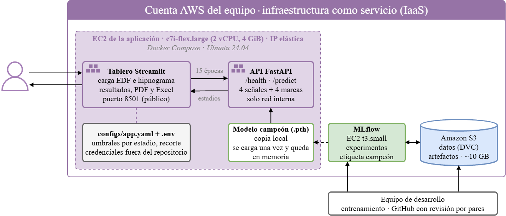

# Guía de conexión y despliegue del tablero

Guía para instalar el tablero, conectarlo con la API de inferencia y
desplegar ambos en AWS EC2. Cada paso indica qué se hace, por qué y cómo
comprobar que quedó bien.

---

## 1. Arquitectura



- El **tablero** no tiene modelos, PyTorch ni el dataset. Lee la señal, la
  prepara, llama a la API y presenta el resultado.
- La **API** es la única que carga modelos. El tablero solo conoce su URL
  (`SLEEP_STAGING_API_URL`).
- Cada uno tiene su imagen Docker. La del tablero pesa mucho menos y arranca
  en segundos.

### Estructura de archivos del tablero

```
app/dashboard/
├── app.py               # punto de entrada y navegación entre etapas
├── config.py            # lee configs/app.yaml y variables de entorno
├── api_client.py        # todas las llamadas HTTP a la API
├── registro.py          # lectura de EDF subidos y estudios de demostración
├── procesamiento.py     # combinaciones, bloques, recorte, indicadores, kappa
├── graficas.py          # figuras Plotly
├── informe.py           # informe PDF y Excel descargables, y texto de hallazgos
├── fuentes/             # URW Gothic (versión libre de Century Gothic) para el PDF
├── textos.py            # todos los textos y ayudas que ve el usuario
├── pantallas/           # carga.py, inferencia.py, resultados.py
├── estudios_demo/       # EDF de demostración (no se versionan) y su .json de descripción
├── tests/               # pruebas + API simulada + datos sintéticos
├── .streamlit/config.toml
├── Dockerfile
├── requirements.txt     # imagen del tablero
└── requirements-dev.txt # pruebas
configs/app.yaml         # parámetros del tablero
```

---

## 2. Contrato con la API

El tablero funciona con la API v0.3.0 tal como está.

### 2.1 `GET /health`
Debe responder 200. El tablero no lee su contenido.

### 2.2 `GET /models` (pendiente en la API)
Si responde **404**, el tablero usa la sección `modelo:` de
`configs/app.yaml` como respaldo. Cuando exista, el tablero toma de aquí qué
combinaciones mostrar habilitadas. Formato esperado:

```json
{
  "modelo": "TinySleepNet",
  "endpoint": "/predict-tinysleepnet",
  "epocas_por_llamada": 15,
  "canales_modelo": ["EEG Fpz-Cz", "EEG Pz-Oz", "EOG horizontal", "EMG submental"],
  "clases": ["W", "N1", "N2", "N3", "REM"],
  "combinaciones": [
    ["EEG Fpz-Cz"], ["EEG Fpz-Cz", "EOG horizontal"],
    ["EEG Fpz-Cz", "EMG submental"], ["EEG Fpz-Cz", "EOG horizontal", "EMG submental"],
    ["EEG Pz-Oz"], ["EEG Pz-Oz", "EOG horizontal"],
    ["EEG Pz-Oz", "EMG submental"], ["EEG Pz-Oz", "EOG horizontal", "EMG submental"],
    ["EEG Fpz-Cz", "EEG Pz-Oz"], ["EEG Fpz-Cz", "EEG Pz-Oz", "EOG horizontal"],
    ["EEG Fpz-Cz", "EEG Pz-Oz", "EMG submental"],
    ["EEG Fpz-Cz", "EEG Pz-Oz", "EOG horizontal", "EMG submental"]
  ]
}
```

- `canales_modelo` es el **orden fijo** de las señales en la entrada, incluidas
  EEG Fpz-Cz, EEG Pz-Oz, EOG horizontal y EMG submental. La casilla de EMG se
  habilita si el archivo contiene esa señal.
- Si el modelo no se pudo cargar al arrancar, conviene responder 503 para que
  el tablero muestre "modelo no disponible".

### 2.3 `POST /predict-tinysleepnet`
Lo que envía el tablero en cada bloque:

```json
{
  "channel_names": ["EEG Fpz-Cz", "EEG Pz-Oz", "EOG horizontal", "EMG submental",
                    "presence EEG Fpz-Cz", "presence EEG Pz-Oz",
                    "presence EOG horizontal", "presence EMG submental"],
  "sampling_rate_hz": 100,
  "signal_unit": "uV",
  "epochs": "[lote][15][8][3000] en µV; cada elemento del lote es una secuencia independiente"
}
```

Detalles que conviene saber:

- **No se descartan épocas.** Si el total no es múltiplo de 15, el último bloque
  se superpone con el anterior y solo se usan sus épocas nuevas.
- Cada solicitud puede llevar hasta `secuencias_por_solicitud` secuencias
  independientes (4 por defecto); cada una mantiene sus 15 épocas de contexto.
- Se envían `solicitudes_paralelas` solicitudes a la vez (4 por defecto).
  FastAPI atiende los endpoints `def` en un grupo de hilos.
- Una noche de Sleep Cassette (unas 2 600 épocas) requiere cerca de 44
  solicitudes con cuatro secuencias por solicitud.

---

## 3. Configuración

Todos los parámetros están en `configs/app.yaml`, con un comentario que explica
cada uno. Los que cambian según el entorno se pueden sobrescribir con variables
de entorno, sin tocar el código:

| Variable | Parámetro en app.yaml | Por defecto | Uso |
|---|---|---|---|
| `SLEEP_STAGING_API_URL` | `api.url` | `http://localhost:8000` | URL de la API. En Docker Compose: `http://api:8000` |
| `TABLERO_TIMEOUT_INFERENCIA_S` | `api.timeout_inferencia_s` | 120 | Espera máxima por bloque |
| `TABLERO_SOLICITUDES_PARALELAS` | `api.solicitudes_paralelas` | 4 | Bloques enviados a la vez |
| `TABLERO_SECUENCIAS_POR_SOLICITUD` | `api.secuencias_por_solicitud` | 4 | Secuencias de 15 épocas agrupadas en cada solicitud (máximo 4) |
| `TABLERO_UMBRALES_CONFIANZA` | `interpretacion.umbrales_confianza` | `W=0, N1=0.65, N2=0, N3=0.66, REM=0.75` | Umbral de "baja confianza" por estadio predicho. La variable puede cambiar solo algunos estadios, p. ej. `N1=0.7,REM=0.8` |
| `TABLERO_TAMANO_MAXIMO_MB` | `carga.tamano_maximo_mb` | 200 | Tamaño máximo de un EDF subido |
| `TABLERO_CARPETA_DEMOS` | `estudios_demo.carpeta` | `app/dashboard/estudios_demo` | Carpeta de los estudios de demostración |
| `TABLERO_CONFIG` | — | `configs/app.yaml` | Otro archivo de configuración |

Otros parámetros que solo están en el YAML: recorte (`margen_min: 30`,
`max_interrupcion_min: 60`, `min_bloque_sueno_min: 5`,
`min_sueno_periodo_min: 30`), alias de nombres de canal y el desempeño de
referencia del modelo (`modelo.desempeno_referencia`, que se muestra en la
tarjeta del modelo cuando deja de ser `null`).

Si cambia `carga.tamano_maximo_mb`, cambie también `server.maxUploadSize` en
`app/dashboard/.streamlit/config.toml`.

---

## 4. Ejecución local

Todos los comandos se ejecutan desde la **raíz del repositorio**.

### 4.1 Instalar dependencias

```bash
pip install -r app/dashboard/requirements-dev.txt
```

### 4.2 Probar el tablero sin la API real (API simulada)

Útil para revisar la interfaz sin MLflow ni modelos. La API simulada tiene el
mismo contrato que la real, pero **no usa ningún modelo**: solo sirve con los
datos sintéticos y nunca debe desplegarse.

```bash
# 1. Generar un registro EDF sintético (PSG + hipnograma) en datos_sinteticos/
python app/dashboard/tests/datos_sinteticos.py datos_sinteticos

# 2. Terminal 1: API simulada en el puerto 8000
uvicorn --app-dir app/dashboard/tests api_simulada:app --port 8000

# 3. Terminal 2: tablero
cd app/dashboard
streamlit run app.py
```

Abra http://localhost:8501, elija **Subir mi registro (EDF)** y suba los dos
archivos de `datos_sinteticos/`.

### 4.3 Probar con la API real

```bash
# Terminal 1: API real con el modelo versionado en modelos/ (no necesita MLflow)
MODEL_PATH=modelos/flexible_emg_mlp_final.pth uvicorn app.api.main:app --port 8000

# Terminal 2
cd app/dashboard
streamlit run app.py
```

### 4.4 Pruebas automáticas

```bash
python -m pytest app/dashboard/tests -q
```

Cubren las 12 combinaciones, el contrato de 8 canales, el recorte, los
indicadores, el kappa, la lectura de EDF, la configuración y los errores de la
API, y la generación del PDF y el Excel.

---

## 5. Estudios de demostración

Se generan una sola vez, en un equipo que tenga el dataset descargado con DVC.
La versión desplegada usa los EDF originales completos de cuatro personas de
prueba (SC4191, SC4241, SC4401 y SC4741):

```bash
dvc pull data/sleep-edfx.dvc data/SC-subjects-split.xlsx.dvc
python scripts/generar_estudios_demo.py \
    --datos data/sleep-edfx/sleep-cassette \
    --particion data/SC-subjects-split.xlsx \
    --sujetos 19 24 40 74 --formato edf
```

- Solo acepta sujetos con `split = test`. Si se le pasa uno de entrenamiento,
  se detiene con un mensaje.
- `--formato edf` copia el PSG y el hipnograma originales sin recorte y crea un
  `.json` de descripción por estudio; `--formato npz` genera una versión
  recortada y compacta.
- Los EDF no se versionan en Git: se copian a `app/dashboard/estudios_demo/`
  en el servidor antes de construir la imagen del tablero. También se puede
  montar otra carpeta e indicarla con `TABLERO_CARPETA_DEMOS`.

---

## 6. Despliegue en AWS EC2

### 6.1 Instancia

- Desplegada: **c7i-flex.large (2 vCPU, 4 GiB de RAM)** con Ubuntu Server
  24.04, en us-east-2. Los dos contenedores usan cerca de 1.9 GiB (API 745 MiB
  y tablero 1.1 GiB); una instancia de 2 GiB no alcanza.
- Disco: 30 GB (las imágenes ocupan 3.1 GB la API y 1.7 GB el tablero).
- Grupo de seguridad:
  - Entrada **TCP 8501** desde `0.0.0.0/0`: el tablero, único puerto público.
  - Entrada **TCP 22** solo desde su IP, para administrar.
  - **No** abrir el 8000: el `docker-compose.yml` propuesto publica la API solo
    en `127.0.0.1`. Si se quiere mostrar `/docs` en la sustentación, ábralo
    temporalmente o cambie la línea `127.0.0.1:8000:8000` por `8000:8000`.

### 6.2 Preparar la instancia (una sola vez)

```bash
sudo apt-get update
sudo apt-get install -y ca-certificates curl git
curl -fsSL https://get.docker.com | sudo sh     # Docker Engine y el plugin de Compose
sudo usermod -aG docker $USER && newgrp docker
docker compose version
```

### 6.3 Desplegar

```bash
git clone <repositorio> && cd proyecto-despliegue-de-soluciones-G10
cp .env.example .env        # con MODEL_USE_MLFLOW=false no hace falta llenar MLflow
# copiar los EDF de las demos a app/dashboard/estudios_demo/ (sección 5)
docker compose up -d --build
docker compose ps           # ambos servicios deben quedar "healthy"
```

`docker compose` levanta primero la API y espera a que `/health` responda
(`depends_on: condition: service_healthy`) antes de arrancar el tablero.

### 6.4 Comprobar

```bash
curl -s http://localhost:8000/health                 # API
curl -s http://localhost:8000/models                 # 404 hasta que exista
curl -s http://localhost:8501/_stcore/health         # tablero: "ok"
```

Desde su navegador: `http://<IP pública de la instancia>:8501`.

Lista de verificación funcional:

- [ ] Aparece el aviso "Herramienta de apoyo, no de diagnóstico".
- [ ] Un estudio de demostración se clasifica completo y muestra la comparación
      con el experto.
- [ ] Un EDF subido **sin** hipnograma se clasifica y no muestra la sección de
      comparación.
- [ ] Al desmarcar los dos EEG aparece el aviso y el botón queda deshabilitado.
- [ ] Las 12 combinaciones funcionan, incluidas las que usan EMG.
- [ ] El informe PDF y los datos por época en Excel se descargan y se abren.
- [ ] Con la API detenida (`docker compose stop api`) el tablero muestra
      "No hay conexión…" y no una traza de Python.

### 6.5 Actualizar y diagnosticar

```bash
git pull && docker compose up -d --build     # actualizar
docker compose logs -f dashboard             # errores del tablero (detalle técnico)
docker compose logs -f api
docker compose restart dashboard
```

El tablero nunca muestra trazas al usuario: el detalle técnico de cada error
queda en `docker compose logs dashboard`.

### 6.6 IP fija

La IP pública de EC2 cambia si la instancia se detiene. Para que la URL de la
publicación no cambie, asocie una **IP elástica** a la instancia. Como toda IPv4
pública en AWS, tiene un costo por hora; revise la tarifa vigente en la consola.

---

## 7. Medición para el README

El README debe reportar tiempos de inferencia. Con la API real en EC2:

1. Clasifique un estudio de demostración.
2. Al final de la pantalla de resultados aparece *Clasificación generada en N s*.
3. Repita con `TABLERO_SOLICITUDES_PARALELAS` en 1, 2 y 4 y anote el tiempo
   por estudio y por época (N / número de épocas).

---

## 8. Estado de la integración con la API

| Elemento | Estado |
|---|---|
| `GET /models` | No existe en la API; el tablero usa la sección `modelo:` de `configs/app.yaml` y deriva de sus cuatro `canales_modelo` las 12 combinaciones |
| Modelo con EMG | Desplegado: el campeón es TinySleepNet flexible con EMG |
| Etiqueta `champion` en MLflow | Run `95951e2a2cfd4368970636cc6bdea9b5`; su copia local está en `modelos/` |
| `desempeno_referencia` | Lleno con la prueba (exactitud 0.826, kappa 0.762); la tarjeta del modelo lo muestra |
