# Manual de usuario del tablero

**Asistente de clasificación de estadios del sueño**

Este manual está dirigido al técnico o profesional de sueño que usa el tablero.
Explica, paso a paso, cómo analizar un registro y qué significa cada elemento
de la pantalla.

> **Herramienta de apoyo, no de diagnóstico.** La clasificación la genera un
> modelo de aprendizaje automático y puede contener errores. Debe ser revisada
> por un profesional del sueño antes de usarse en cualquier decisión clínica.

---

## 1. Qué hace el tablero

El tablero recibe una polisomnografía (PSG) y clasifica cada periodo de 30
segundos (una **época**) en uno de cinco estadios:

| Estadio | Significado |
|---|---|
| W | Vigilia |
| N1 | Sueño ligero (transición) |
| N2 | Sueño ligero estable |
| N3 | Sueño profundo (ondas lentas) |
| REM | Sueño con movimientos oculares rápidos |

Con esa clasificación construye el hipnograma, calcula indicadores del sueño,
señala las épocas en las que el modelo tuvo dudas y permite descargar el
resultado.

El uso tiene tres etapas, que se ven en la parte superior de la pantalla y se
resumen en la Figura 1: **1 · Carga del registro**, donde se elige el registro
y las señales; **2 · Clasificación**, mientras el modelo trabaja; y
**3 · Resultados**, donde se revisa y se descarga el análisis. Desde los
resultados, el botón *Analizar otro registro* vuelve a la primera etapa.

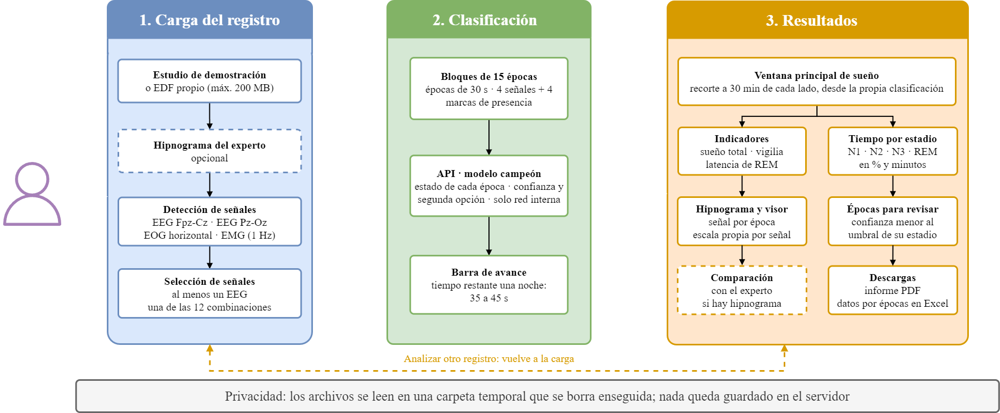

*Figura 1. Las tres etapas del tablero y lo que ocurre en cada una.*

---

## 2. Etapa 1: carga del registro

Es la primera sección de la interfaz. Tiene dos pasos, **1. Registro** y
**2. Señales**, y termina con la tarjeta del modelo y el botón
**Generar clasificación**.

### 2.1 Paso 1: Registro

En **1. Registro** encontrará dos opciones: *Estudio de demostración* y
*Subir mi registro (EDF)*.

**Estudio de demostración.** Son registros reales de la base pública Sleep-EDFx
(Sleep Cassette) de personas que **no** se usaron para entrenar el modelo, e
incluyen el hipnograma del experto para comparar. Al abrir el menú *Estudio*
aparecen los cuatro estudios disponibles (Figura 2), y puede elegir cualquiera:

| Estudio | Persona |
|---|---|
| SC4191E0 | Hombre de 28 años, noche 1 |
| SC4241E0 | Mujer de 54 años, noche 1 |
| SC4401E0 | Mujer de 67 años, noche 1 |
| SC4741E0 | Hombre de 92 años, noche 1 |

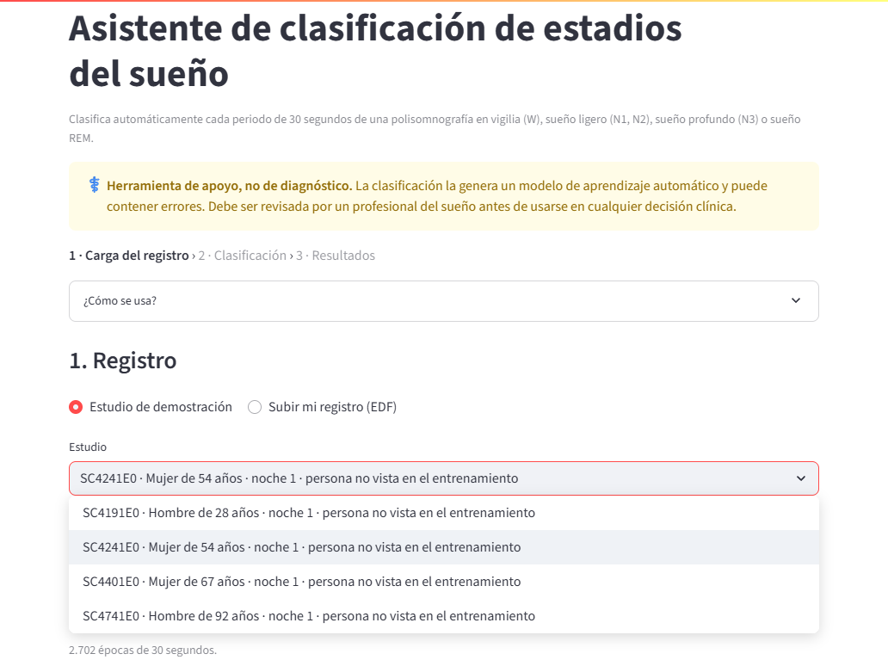

*Figura 2. Opción «Estudio de demostración»: el menú muestra los cuatro
estudios; en este manual se usa SC4241E0.*

**Subir mi registro (EDF).** Aparecen dos cuadros para cargar archivos
(Figura 3):

- *Archivo de señales (PSG)*, **obligatorio**. Formato EDF o EDF+, máximo
  200 MB, con al menos un EEG (Fpz-Cz o Pz-Oz).
- *Hipnograma del experto*, **opcional**. Si lo sube, el tablero compara la
  clasificación del modelo con la del experto.

Puede arrastrar cada archivo a su cuadro o pulsar *Browse files* para buscarlo.
Los textos del cuadro están en inglés (*Drag and drop file here*, *Browse
files*) porque es el componente estándar de la herramienta con la que se
construyó el tablero. Los archivos se procesan solo durante su sesión y no se
guardan en el servidor.

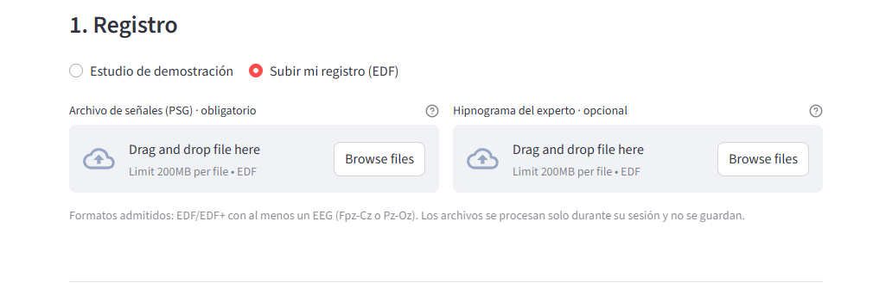

*Figura 3. Opción «Subir mi registro (EDF)»: archivo de señales (obligatorio) e
hipnograma del experto (opcional).*

Al seleccionar un estudio o leer el archivo subido, el tablero muestra la
**duración del registro**, la **hora de inicio de la grabación**, si hay
**hipnograma del experto** y el número de épocas de 30 segundos (Figura 4). Si
alguna señal venía a una frecuencia distinta de 100 Hz, la ajusta y lo informa.

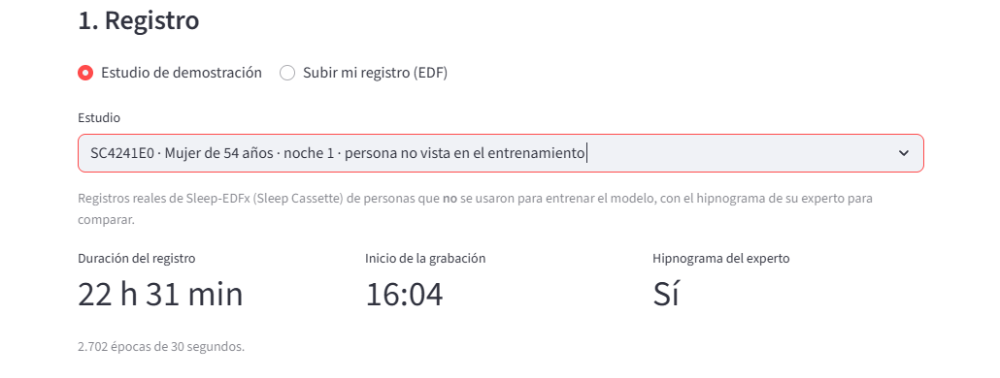

*Figura 4. SC4241E0 seleccionado: 22 h 31 min de registro, grabación iniciada a
las 16:04, con hipnograma del experto y 2 702 épocas.*

### 2.2 Paso 2: Señales

En **2. Señales** el tablero revisa qué señales contiene el registro y muestra
cuatro casillas (Figura 5):

| Casilla | Para qué le sirve al modelo |
|---|---|
| EEG Fpz-Cz (frontal) | Distinguir el sueño profundo (N3) |
| EEG Pz-Oz (posterior) | Reconocer el ritmo alfa de la vigilia relajada |
| EOG horizontal | Reconocer el sueño REM y la vigilia |
| EMG submental | Separar REM de vigilia por el tono muscular |

Debajo de cada casilla aparece su estado:

- ✅ **Disponible**: la señal está en el archivo y el modelo la usa.
- ⛔ **No está en el archivo**: el registro no la trae.
- ⛔ **El modelo aún no la usa**: la señal existe, pero el modelo activo no fue
  entrenado con ella. Con el modelo actual no aparece, porque usa las cuatro
  señales.

**Regla:** se necesita **al menos una señal EEG** (Fpz-Cz o Pz-Oz). EOG y EMG
son opcionales. Esto da 12 combinaciones posibles:

| EEG | Solo EEG | + EOG | + EMG | + EOG + EMG |
|---|---|---|---|---|
| Fpz-Cz | 1 | 2 | 3 | 4 |
| Pz-Oz | 5 | 6 | 7 | 8 |
| Fpz-Cz + Pz-Oz | 9 | 10 | 11 | 12 |

El tablero indica en verde qué combinación eligió (en la Figura 5,
*Combinación 12 de 12*). Si la selección no es válida, explica por qué y no
deja continuar.

**Sobre el EMG.** El modelo se entrenó con el EMG tal como viene en Sleep-EDF:
la envolvente del tono muscular, con un valor por segundo (1 Hz). Si el archivo
trae el EMG a otra frecuencia (por ejemplo, la señal cruda a 100 Hz o más), el
tablero no lo usa, lo informa con un aviso y continúa con las demás señales.

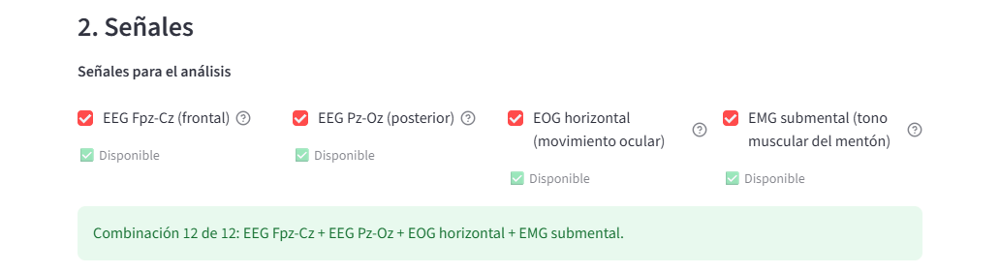

*Figura 5. Las cuatro señales de SC4241E0 están disponibles y marcadas: el
tablero usará la combinación 12 de 12.*

### 2.3 Modelo y Generar clasificación

El tablero usa un único modelo, el que obtuvo el mejor desempeño en la
evaluación del proyecto. La tarjeta *Modelo de clasificación* indica cuál es y
qué tan bien coincidió con los expertos en personas que no participaron en su
entrenamiento: 83 % de las épocas, con un kappa de 0.76, igual al acuerdo
habitual entre dos expertos (Figura 6).

Pulse **Generar clasificación** para continuar.

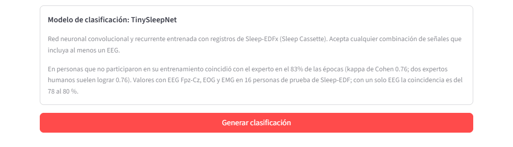

*Figura 6. Tarjeta del modelo TinySleepNet con su desempeño en personas no
vistas, y el botón para iniciar la clasificación.*

---

## 3. Etapa 2: clasificación

Aparece el aviso **«Estamos generando la clasificación»**, con el registro y
las señales que se están analizando, una barra de avance y el tiempo estimado
restante (Figura 7). Mientras tanto el tablero:

1. Clasifica cada época del registro con el modelo.
2. Ubica el periodo principal de sueño.
3. Calcula los indicadores.

No cierre ni recargue la página. La duración depende del largo del registro:
en la versión desplegada, una noche de Sleep Cassette (de 20 a 23 horas
grabadas) tarda entre 35 y 45 segundos con las cuatro señales. Si el servicio no
responde, el tablero lo indica con un mensaje y un botón para volver a
intentarlo.

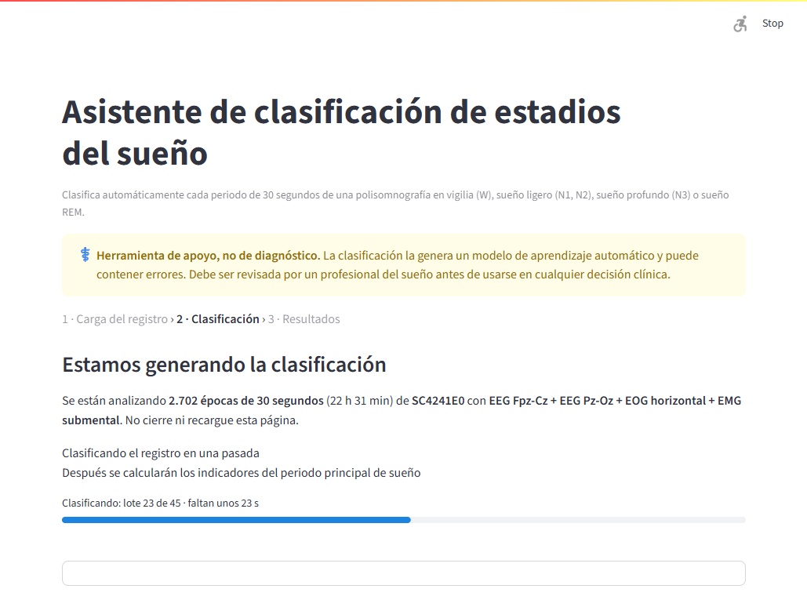

*Figura 7. Clasificación en curso de SC4241E0: lote 23 de 45 y unos 23 s
restantes.*

---

## 4. Etapa 3: resultados

Cuando termina, el tablero pasa a **3 · Resultados**. La pantalla se recorre de
arriba hacia abajo: ficha del análisis, resumen del sueño, hipnograma, señal
por época, comparación con el experto y descargas.

### 4.1 Ficha del análisis

Resume qué se analizó: el registro, las señales usadas (y su número de
combinación), el modelo y la **ventana analizada** (Figura 8).

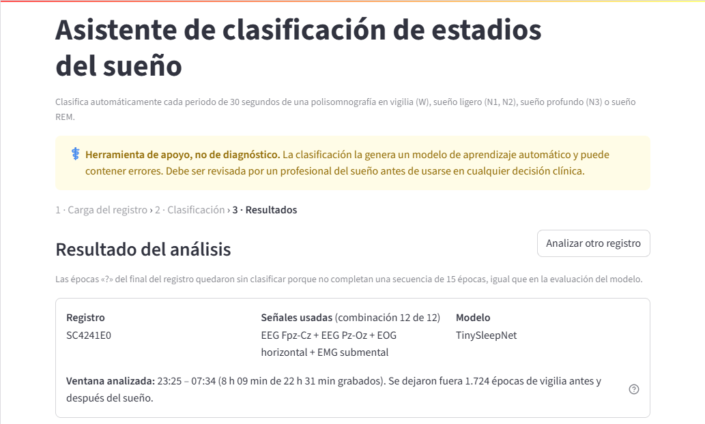

*Figura 8. Ficha de SC4241E0: se analizó de 23:25 a 07:34 (8 h 09 min de las
22 h 31 min grabadas) y se dejaron fuera 1 724 épocas de vigilia antes y después
del sueño.*

**Por qué hay una ventana analizada.** Un registro de Sleep Cassette dura cerca
de 20 horas y la mayor parte es vigilia de día. El modelo se entrenó con la noche
recortada a 30 minutos antes y después del sueño, así que analiza la misma
ventana. Como un registro nuevo no trae hipnograma, el tablero clasifica primero
el registro completo y luego ubica el periodo principal de sueño a partir de esa
misma clasificación:

- solo cuentan tramos de sueño de al menos 5 minutos seguidos, para que una
  época suelta durante el día no adelante el inicio;
- los despertares de menos de 60 minutos se consideran parte de la misma noche;
- si hay varias siestas, se toma el periodo con más sueño.

Todos estos valores se pueden ajustar en la configuración.

Las últimas épocas del registro pueden aparecer como «?»: el modelo clasifica
secuencias de 15 épocas y las que no completan una secuencia quedan sin
clasificar, igual que en la evaluación del modelo. Son vigilia del final de la
grabación y no afectan los indicadores.

### 4.2 Resumen del sueño

Los indicadores se calculan dentro de la ventana analizada (Figura 9). Al pasar
el cursor sobre el ícono **?** de cada uno, el tablero explica qué mide.

| Indicador | Qué mide | Qué le dice al usuario |
|---|---|---|
| Tiempo total de sueño | Suma de las épocas N1, N2, N3 y REM | Cuánto durmió la persona |
| Inicio – fin del sueño | Hora de la primera y la última época de sueño sostenido | Cuándo empezó y terminó la noche |
| Despierto tras dormirse | Minutos en vigilia entre el inicio y el fin del sueño (WASO) | Si el sueño fue continuo o fragmentado |
| Latencia de REM | Minutos desde que la persona se duerme hasta su primera época REM | Si el primer ciclo de sueño fue típico: en adultos suele estar entre 70 y 120 min; un valor muy distinto merece revisión |
| Épocas para revisar | Épocas con confianza menor al umbral del estadio que eligió el modelo (N1 65 %, N3 66 %, REM 75 %; W y N2 no se marcan) | Cuánto trabajo de revisión manual requiere el estudio |

Debajo de los indicadores, **Tiempo en cada estadio** muestra en recuadros
pequeños el porcentaje del tiempo total de sueño y los minutos de N1, N2, N3 y
REM, cada uno con el borde de su color. Es un dato estándar de los informes de
polisomnografía: permite ver, por ejemplo, si hubo poco sueño profundo o poco
REM. La vigilia dentro de la ventana se informa aparte, porque no es sueño.

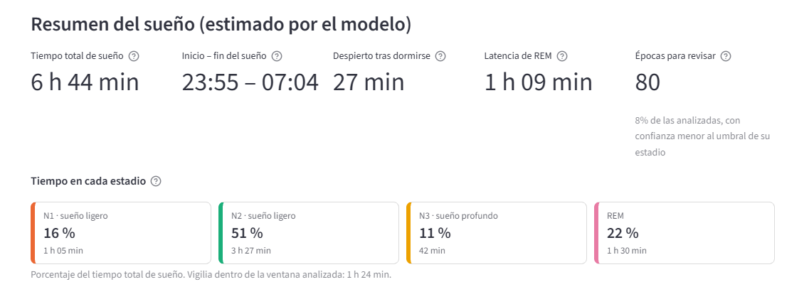

*Figura 9. Resumen de SC4241E0: 6 h 44 min de sueño, de 23:55 a 07:04, 27 min
despierto tras dormirse, primer REM a 1 h 09 min y 80 épocas para revisar.*

**Indicadores que se decidió no mostrar:**

- *Eficiencia del sueño*. Clínicamente es el tiempo dormido dividido entre el
  tiempo en cama. El archivo no indica cuándo se apagaron las luces, así que el
  valor sería engañoso.
- *Latencia de sueño*. Por la misma razón: se mide desde que se apagan las
  luces, dato que no está disponible.

### 4.3 Hipnograma

Muestra el estadio clasificado a lo largo de la noche, con la hora en el eje
horizontal (Figura 10):

- **Orden clínico habitual:** W arriba, luego REM, N1, N2 y N3 abajo.
- **Bloques de color:** cada bloque es el estadio de esas épocas, con el mismo
  color en todo el tablero y en los archivos descargados.
- **Línea negra:** une los estadios y muestra cómo la persona pasa de uno a otro.
- **Marcas grises** debajo del modelo: épocas de baja confianza para revisar.
- Si subió el hipnograma del experto, se muestra **debajo, con el mismo
  formato**, y una **franja inferior marca en rojo** las épocas en que modelo y
  experto no coinciden. Se puede ocultar con el interruptor *Mostrar el
  hipnograma del experto y las coincidencias*.

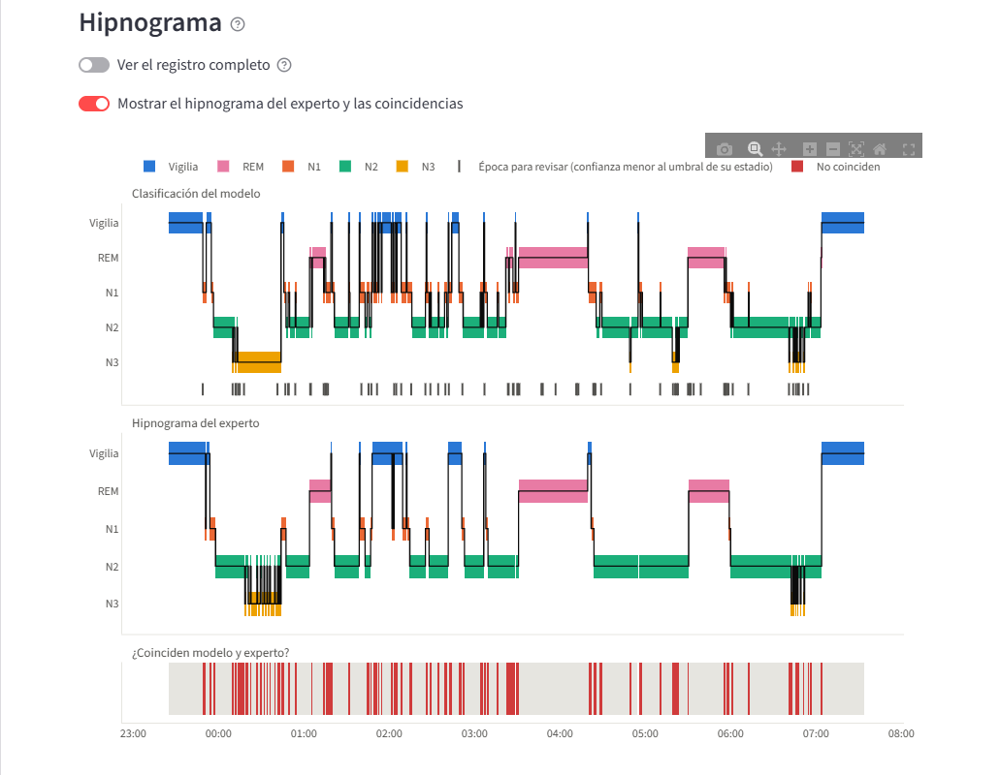

*Figura 10. Hipnograma de la ventana analizada: arriba el modelo, abajo el
experto y, al final, en rojo las épocas en que no coinciden.*

El interruptor **Ver el registro completo** muestra también la vigilia fuera de
la ventana analizada, de principio a fin de la grabación (Figura 11).

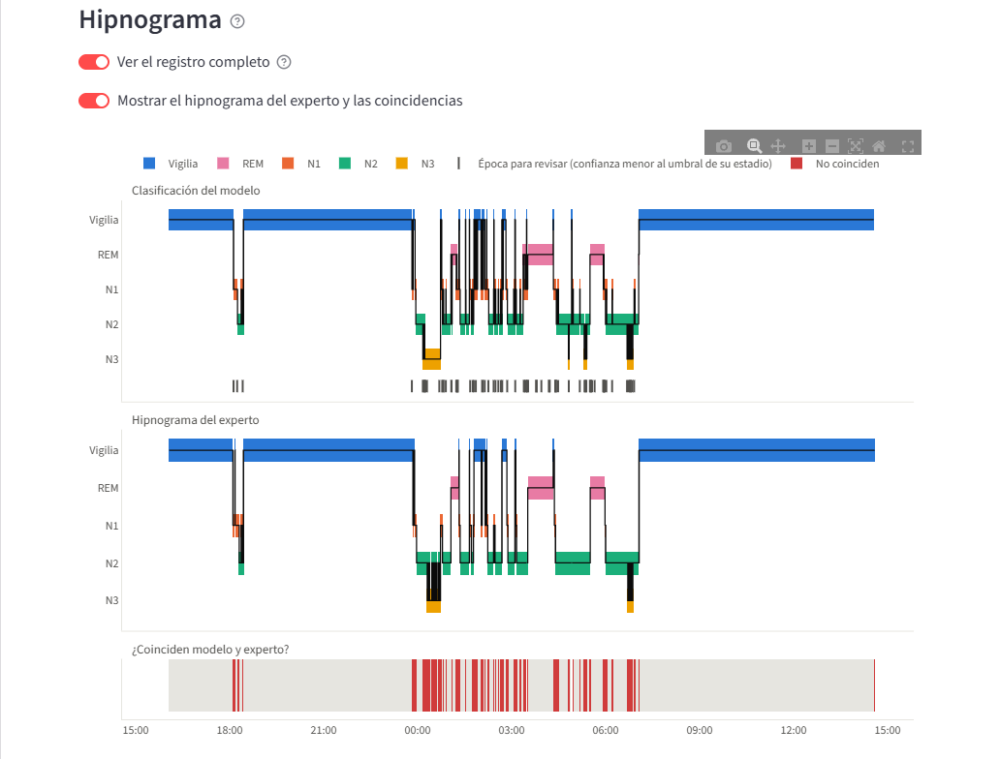

*Figura 11. Con «Ver el registro completo» activado se ve toda la grabación: la
noche queda entre largos periodos de vigilia diurna.*

### 4.4 Señal y clasificación por época

Muestra las señales registradas, **cada una con su propio color** y su nombre a
la izquierda, sobre un fondo limpio. Encima de cada época hay una **franja con
el estadio clasificado** (su color y su nombre; ⚠ si la confianza es baja), y
líneas grises separan las épocas de 30 segundos (Figura 12). Sirve para
verificar en la señal por qué el modelo eligió cada estadio, igual que se hace
al calificar un estudio.

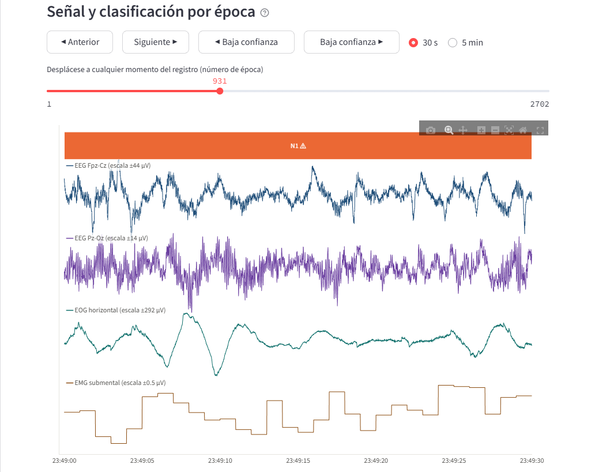

*Figura 12. Época 931 en la vista de 30 s: el modelo la clasificó como N1 con
baja confianza (⚠).*

Para moverse por el registro:

- **Anterior / Siguiente**: avanza de a una época.
- **◀ Baja confianza / Baja confianza ▶**: salta a la época dudosa anterior o
  siguiente. Es la forma más rápida de revisar el estudio.
- **30 s / 5 min**: una sola época (la ventana clínica habitual) o diez épocas
  para ver el contexto. En la vista de 5 minutos, la época seleccionada se
  resalta con un fondo gris suave (Figura 13).
- La barra deslizante permite ir a cualquier momento del registro.

**Escala de cada señal.** Las señales tienen amplitudes muy distintas: el EEG
frontal puede superar los 50 µV y la envolvente del EMG rara vez pasa de unos
pocos µV. Para que todas se vean, cada una se dibuja con su propia escala
vertical, indicada junto a su nombre (por ejemplo, *escala ±44 µV*). Al pasar
el cursor sobre la señal se ve su valor real en µV. El EMG tiene un valor por
segundo, por eso se ve escalonado.

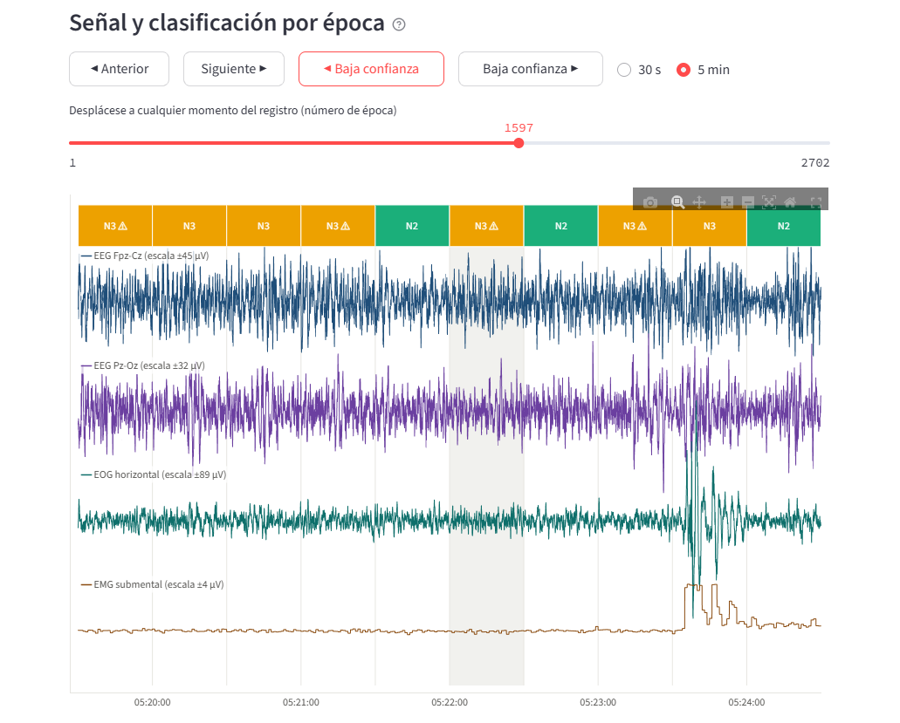

*Figura 13. Vista de 5 minutos alrededor de la época 1 597, resaltada en gris:
una secuencia de N3 y N2 con varias épocas N3 marcadas ⚠.*

Debajo de las señales se muestra el detalle de la época seleccionada
(Figura 14):

- **Clasificación del modelo** y **confianza**.
- **Segunda opción del modelo**: el estadio con la segunda probabilidad más
  alta. Indica entre qué dos estadios dudó el modelo. Por ejemplo, si la
  confianza es baja y la segunda opción es REM, conviene mirar en la señal los
  movimientos oculares (EOG) y el tono muscular para decidir.
- La etiqueta del **experto**, si se cargó el hipnograma, y si coincide.

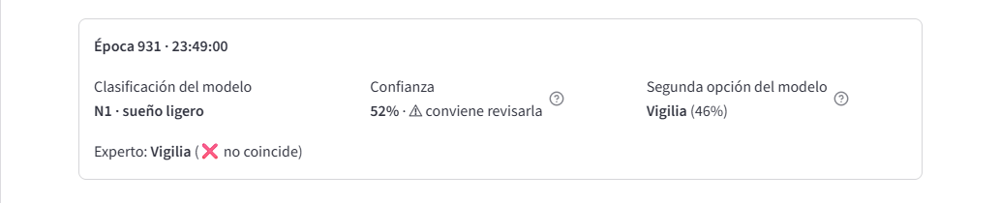

*Figura 14. Detalle de la época 931: el modelo eligió N1 con 52 % de confianza
(⚠, conviene revisarla) y su segunda opción fue vigilia (46 %); el experto
marcó vigilia, justo la segunda opción.*

**Qué es la confianza.** Es la probabilidad que el modelo asigna al estadio
elegido, de 0 a 100 %. No es una garantía de acierto: una época con confianza
alta también puede estar mal clasificada. Pero las de confianza baja merecen
revisión prioritaria.

### 4.5 Comparación con el experto

Solo aparece si hay hipnograma del experto (Figura 15).

- **Coincidencia con el experto**: porcentaje de épocas en que coinciden.
- **Kappa de Cohen**: corrige las coincidencias que ocurrirían por azar
  (1 = acuerdo perfecto, 0 = azar). Como referencia, el acuerdo entre expertos
  humanos ronda un kappa de 0.76 (metaanálisis de Lee et al., 2022). Es una
  referencia, no una meta de equivalencia.
- **Matriz de confusión**: cada fila es lo que dijo el experto y cada columna
  lo que dijo el modelo. La diagonal son los aciertos; fuera de ella se ve con
  qué estadio se confunde cada uno.

Las épocas que el experto marcó como movimiento o no puntuó se excluyen, porque
el modelo no predice esas categorías.

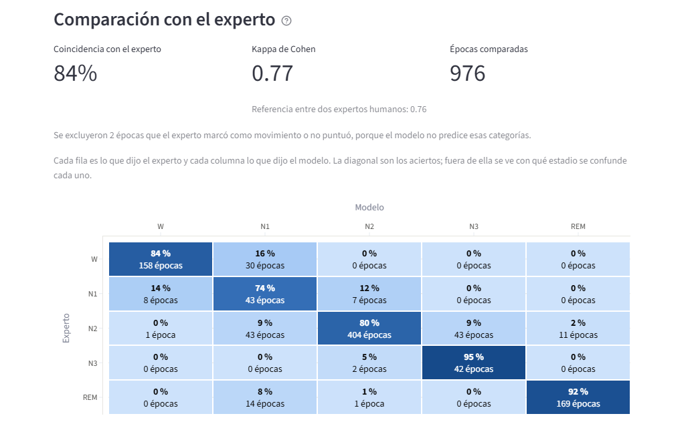

*Figura 15. Comparación de SC4241E0: 84 % de coincidencia y kappa de 0.77 en
976 épocas.*

> 🛑 **Si no cargó el hipnograma del experto**, esta sección no aparece y el
> hipnograma muestra solo la clasificación del modelo, sin la franja de
> coincidencias. La ventana analizada y los indicadores se calculan igual.

### 4.6 Descargar resultados

Al final de la página hay dos botones de descarga, para dos usos distintos
(Figura 16).

Los dos archivos incluyen **Hallazgos**: un resumen en palabras de lo que
muestran los indicadores (cuánto y cuándo durmió la persona, cómo se repartió la
noche, si el primer REM llegó dentro del rango habitual en adultos, cuántas
épocas conviene revisar y, si hay hipnograma del experto, qué tanto coincidió
el modelo y cuál fue la diferencia más frecuente). Es descriptivo: no
interpreta ni diagnostica. Se dejó solo en los archivos porque en la página
repetiría lo que ya muestran los indicadores y las gráficas.

**Informe (PDF)**, para leer, imprimir o adjuntar al estudio. Tiene tres páginas:

1. *Resumen:* aviso de herramienta de apoyo, datos del análisis, los 5
   indicadores, los hallazgos y la distribución de los estadios.
2. *Hipnograma* de la ventana analizada y, si hay hipnograma del experto, la
   comparación (coincidencia, kappa y matriz de confusión).
3. *Épocas para revisar*, de la menos a la más confiable (hasta 80), y cómo se
   generó el informe.

**Datos por época (Excel)**, para analizar. Tiene cuatro hojas:

| Hoja | Contenido |
|---|---|
| Resumen | Hallazgos, datos del análisis, indicadores con lo que mide cada uno, distribución, comparación con el experto y la imagen del hipnograma |
| Épocas | Una fila por época con filtros: hora, estadio (con su color), confianza, si conviene revisarla, si está en la ventana analizada, probabilidad de cada estadio y, si lo subió, la etiqueta del experto y si coincide |
| Para revisar | Solo las épocas de baja confianza, ordenadas de la menos a la más confiable, con la segunda opción del modelo |
| Cómo leer | Qué significa cada columna y cada término |

Ambos archivos usan la fuente Century Gothic. En el PDF, si el servidor no
tiene Century Gothic instalada, se usa URW Gothic, una versión libre del mismo
diseño.

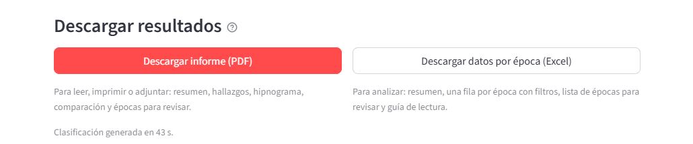

*Figura 16. Descargas: el informe en PDF y los datos por época en Excel. Debajo
se indica cuánto tardó la clasificación.*

Pulse **Analizar otro registro**, en la ficha del análisis, para volver a la
etapa 1.

---

## 5. Mensajes frecuentes

| Mensaje | Qué hacer |
|---|---|
| *El archivo no contiene ninguna de las señales que el modelo reconoce* | Verifique que el EDF tenga un canal EEG Fpz-Cz o Pz-Oz. |
| *Seleccione al menos una señal EEG* | Marque Fpz-Cz, Pz-Oz o ambas. |
| *El registro dura menos de 7.5 minutos* | El modelo analiza secuencias de 15 épocas; use un registro más largo. |
| *Se descartó el EMG submental porque viene a … Hz; el modelo requiere 1 Hz* | El archivo trae el EMG crudo u otra frecuencia. El análisis sigue con las demás señales; no hace falta hacer nada. |
| *… venía a … Hz y se ajustó a 100 Hz* | El EEG o el EOG se remuestrearon a la frecuencia con la que se entrenó el modelo. Es informativo. |
| *No hay conexión con el servicio de clasificación* | Espere unos minutos y pulse *Reintentar conexión*. |
| *El modelo no está disponible en este momento* | El servicio está iniciando o sin acceso a los modelos; intente más tarde. |

---

## 6. Limitaciones

- El modelo se entrenó con Sleep Cassette (personas sanas de 25 a 101 años,
  registros en casa). En otras poblaciones o equipos de registro su desempeño
  puede ser menor.
- La ventana de análisis se estima con la propia clasificación; en registros
  muy fragmentados conviene revisar en el hipnograma completo que la ventana
  sea la correcta.
- Los indicadores son estimaciones a partir de la clasificación automática y
  heredan sus errores.
- El EMG solo se usa si viene como envolvente de 1 Hz, igual que en Sleep-EDF.
  Los equipos que guardan el EMG crudo a alta frecuencia se analizan con EEG y
  EOG.

---

## Anexo: por qué la interfaz muestra lo que muestra

| Elemento | Por qué está | Qué le dice al usuario |
|---|---|---|
| Aviso de herramienta de apoyo | El modelo comete errores y el resultado no debe usarse sin revisión profesional | Que la clasificación es una propuesta para revisar, no un diagnóstico |
| Un solo modelo | El usuario necesita el resultado más confiable, no elegir algoritmos. La comparación entre modelos se presenta en el artículo del proyecto | Qué modelo se usó y, cuando está configurado, qué tan bien rinde en personas no vistas |
| Regla de al menos un EEG y 12 combinaciones | El modelo necesita EEG para clasificar; EOG y EMG aportan información adicional, como pide la propuesta del proyecto | Qué señales puede usar con su registro y por qué una selección no es válida |
| Casillas deshabilitadas con motivo | Evitan elegir algo que terminaría en error | Si la señal falta en el archivo o si el modelo aún no la usa |
| Aviso "Estamos generando la clasificación" | La clasificación de una noche toma tiempo y sin aviso parece que la página se congeló | Que el sistema está trabajando y cuánto falta |
| Ventana analizada | El modelo se entrenó con la noche recortada a ±30 min del sueño; analizar 20 h de vigilia diurna produciría errores y distorsionaría los indicadores | Qué parte del registro se analizó y cuánta vigilia se dejó fuera |
| Tiempo total de sueño, inicio–fin, despierto tras dormirse, latencia de REM | Son indicadores estándar del hipnograma que se pueden calcular sin la hora de apagado de luces | Cuánto durmió, cuándo y qué tan fragmentado fue el sueño |
| Sin eficiencia ni latencia de sueño | Ambas requieren la hora de apagado de luces, que el EDF no trae; mostrarlas daría valores engañosos | — |
| Épocas para revisar y umbrales de confianza por estadio | La revisión manual de una noche completa es larga; priorizar las épocas dudosas la acelera. Un umbral único marcaría demasiadas épocas de los estadios fáciles (W, N2) y muy pocas de los difíciles (N1); por recomendación de los expertos, cada estadio tiene su umbral, fijado en la validación cruzada para que lo no marcado alcance el desempeño por estadio de SleepFM menos 5 puntos | Cuántas épocas conviene revisar y dónde están |
| Hipnograma con bloques de color y línea negra, en orden clínico y con eje en horas | El orden y la línea escalonada son la convención clínica; los colores permiten reconocer cada estadio sin leer el eje | La arquitectura del sueño en la noche y cómo se pasa de un estadio a otro |
| Hipnograma del experto en panel aparte y franja de coincidencias | Superponer dos líneas en la misma gráfica no se distinguía; en paneles separados se comparan sin confundirse | Dónde coinciden modelo y experto, y dónde conviene revisar |
| Hallazgos en texto, solo en el PDF y el Excel | Quien recibe el archivo no tiene la página delante; un resumen en palabras le hace comprensibles los números. En la página sería repetitivo | Lo más importante del estudio en pocas líneas |
| Tiempo en cada estadio, en recuadros compactos | Es un dato estándar de los informes de polisomnografía; en recuadros ocupa poco espacio | Cómo se repartió la noche entre los estadios |
| Flujo en tres etapas | Separar cargar, esperar y revisar evita que el usuario cambie la selección mientras el modelo trabaja y deja claro en qué paso está | Qué tiene que hacer ahora y qué viene después |
| Escala propia por señal | Con una escala común, el EMG (unos pocos µV) se veía plano junto al EEG; con su propia escala se ven todas y el valor real sigue disponible al pasar el cursor | La forma de cada señal en la época, incluido el tono muscular |
| Visor de señal: un color por señal, fondo limpio y franja de estadio encima | Así se califica el sueño: mirando la señal época por época. Los colores distinguen las señales sin confundirse con los estadios | Por qué el modelo eligió cada estadio y si conviene corregirlo |
| Segunda opción del modelo | La confianza sola no dice entre qué estadios dudó el modelo; una gráfica de 5 probabilidades ocupaba espacio sin aportar más | Qué mirar en la señal para decidir entre los dos estadios |
| Kappa y referencia entre expertos | La exactitud sola se infla por la vigilia y N2, que son los estadios más frecuentes; el kappa corrige el azar y la referencia humana da contexto | Si el acuerdo con el experto es comparable al de dos expertos entre sí |
| Matriz de confusión | Muestra qué estadios se confunden entre sí | Por ejemplo, si N1 tiende a clasificarse como N2 o REM |
| Informe PDF | El resultado de un estudio se guarda, imprime y comparte como documento | Un informe completo y presentable del estudio |
| Excel por época | El usuario necesita revisar, filtrar y llevar los datos a su propio flujo de trabajo | Toda la clasificación, época por época, organizada y explicada |
| Colores por estadio | Paleta validada para daltonismo; además el estadio siempre va acompañado de su nombre o de su posición en el eje | Identificar estadios sin depender solo del color |
| Errores en lenguaje llano | Una traza de Python no le sirve al usuario y puede exponer datos internos | Qué pasó y qué hacer |
