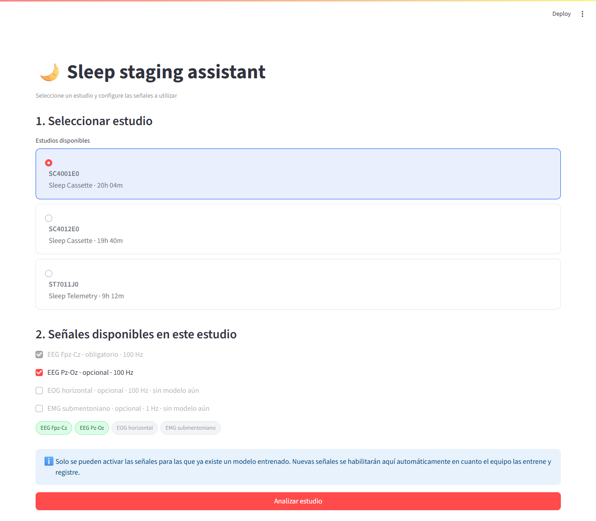
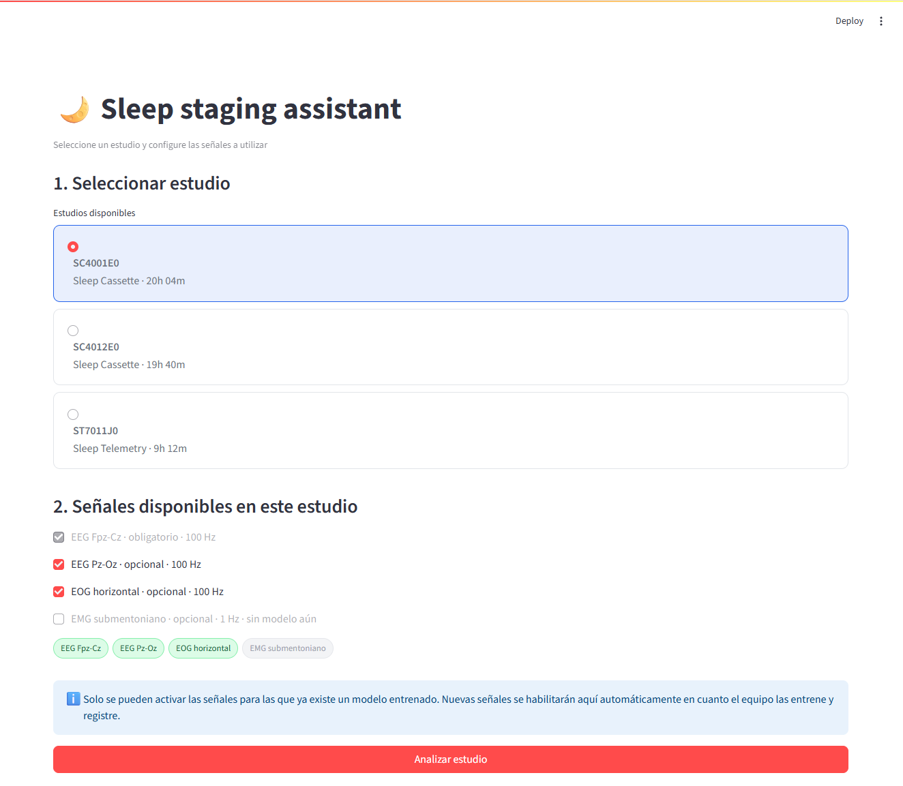
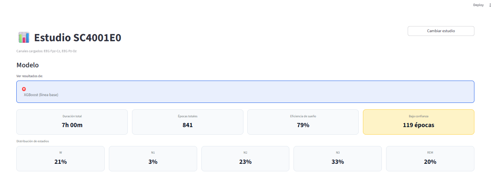
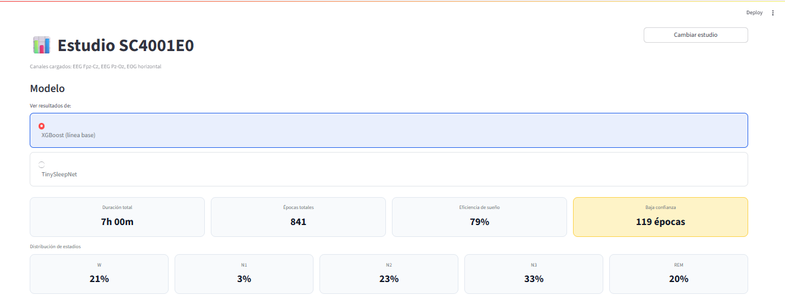
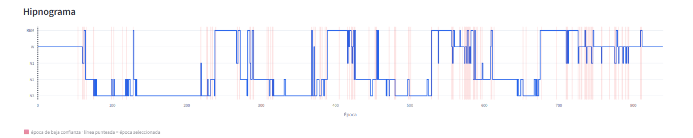
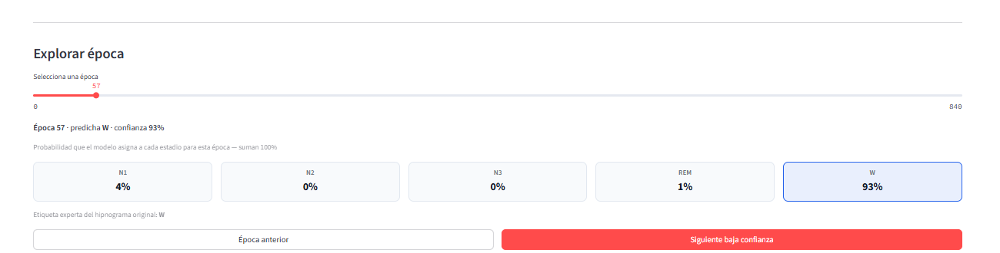
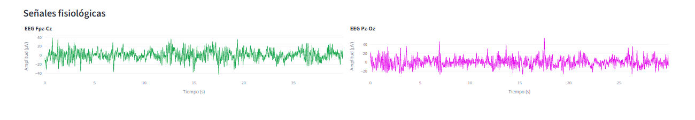

# Manual de Usuario — 🌙 Sleep Staging Assistant 

**Dirigido a:** técnicos de polisomnografía (PSG) que revisan estudios de sueño.

**Versión:** Entrega 3 con capturas del tablero funcionando con predicciones reales, incluyendo los dos modelos disponibles (XGBoost y TinySleepNet).

---

## 1. Introducción

Sleep Staging Assistant es una herramienta de apoyo para la revisión de estudios de polisomnografía. A partir de las señales fisiológicas registradas durante la noche, clasifica automáticamente cada segmento de 30 segundos (época) en uno de los cinco estadios del sueño: **W** (vigilia), **N1**, **N2**, **N3** y **REM**.

**Esta herramienta no reemplaza el criterio del especialista ni constituye un diagnóstico clínico.** Su función es reducir el tiempo de revisión manual, dirigiendo su atención hacia las épocas donde el modelo tiene menor certeza en su predicción, en vez de requerir que revise una por una las cerca de 800 a 1200 épocas que puede tener una noche completa de registro.

No necesita ningún conocimiento técnico de programación ni de los modelos de inteligencia artificial detrás de la herramienta para usarla, solo el estudio que desea analizar.

---

## 2. Paso 1: Seleccionar un estudio y las señales

Al abrir la herramienta, la primera pantalla le presenta la lista de estudios disponibles, cada uno con su tipo de origen y duración total, y las señales fisiológicas que puede activar para el análisis:

- **Sleep Cassette (SC):** registros de sujetos sanos, sin medicación relacionada con el sueño.
- **Sleep Telemetry (ST):** registros de sujetos con dificultad leve para conciliar el sueño.

Seleccione el estudio que desea analizar haciendo clic sobre la tarjeta correspondiente.

Debajo, encontrará las señales fisiológicas disponibles para activar:

| Señal | Estado |
|---|---|
| EEG Fpz-Cz | Siempre activa, es la señal mínima requerida y no se puede desactivar |
| EEG Pz-Oz | Opcional |
| EOG horizontal | Opcional |
| EMG submentoniano | Opcional |

**Importante:** solo puede activar una señal opcional si ya existe un modelo entrenado que la utilice. Si una señal aparece marcada como *"sin modelo aún"* (como EMG submentoniano en la captura), el sistema no le permitirá activarla, esto no es un error, simplemente significa que el equipo todavía no ha entrenado un modelo que use esa combinación de señales. Esta lista se actualiza automáticamente a medida que el equipo entrena y habilita nuevos modelos, sin que usted deba hacer nada distinto.

La combinación de señales que active aquí determina **qué modelos estarán disponibles para elegir en el siguiente paso**, por eso es importante activar todas las señales que le interesan antes de continuar. Por ejemplo, si activa EEG Fpz-Cz, EEG Pz-Oz y EOG horizontal a la vez (como en la captura siguiente), tendrá acceso tanto al modelo de línea base como al modelo avanzado en el paso 2:

Una vez conforme con su selección, haga clic en **"Analizar estudio"**. La carga puede tardar hasta un minuto, ya que el sistema procesa la señal real del estudio completo.

---

## 3. Paso 2: Elegir el modelo

En la pantalla de análisis, justo debajo del encabezado del estudio, encontrará la sección **"Modelo"**, con la opción de ver los resultados calculados por cada modelo disponible:

- Solo aparecen como opción los modelos que pueden calcularse con las señales que usted activó en el paso anterior. En la captura del paso 2 solo "XGBoost (línea base)" aparece disponible porque esas eran las únicas señales activadas; si en cambio activó EEG Fpz-Cz + EOG horizontal (como en la captura de abajo), la opción **"TinySleepNet"** también aparece en el selector:

- Si activó pocas señales, es posible que solo un modelo esté disponible. Si desea comparar más de un modelo, vuelva al paso anterior (botón **"Cambiar estudio"**) y active las señales adicionales que el modelo que busca necesite.
- Cambiar de modelo aquí **no vuelve a cargar el estudio** solo recalcula las predicciones con el modelo elegido, así que puede alternar entre modelos disponibles para comparar sus resultados sobre el mismo estudio. La primera vez que elige un modelo en la sesión, verá un indicador de carga ("Calculando predicciones con...") mientras el sistema ejecuta el modelo sobre el estudio completo; las siguientes veces que vuelva a ese mismo modelo, el resultado ya calculado se muestra de inmediato.

---

## 4. Interpretar el resumen del estudio

En la misma vista de arriba, encontrará cuatro indicadores generales:

- **Duración total:** duración del registro analizado, después de descontar los periodos prolongados de vigilia al inicio y al final de la noche.
- **Épocas totales:** número de segmentos de 30 segundos que componen el estudio.
- **Eficiencia de sueño:** porcentaje del registro que el modelo clasificó en algún estadio de sueño (no vigilia).
- **Baja confianza:** número de épocas donde el modelo tiene menos de un 65% de certeza en su predicción, estas son las que ameritan su revisión prioritaria. En el ejemplo de la captura, 119 de 841 épocas quedaron marcadas así.

Debajo, la **distribución de estadios** muestra qué porcentaje del estudio corresponde a cada una de las cinco etapas (W, N1, N2, N3, REM).

Estos mismos indicadores se recalculan automáticamente cuando cambia de modelo en la sección "Modelo", así puede comparar, por ejemplo, cuántas épocas de baja confianza reporta XGBoost frente a TinySleepNet sobre el mismo estudio.

---

## 5. Leer el hipnograma

El hipnograma es la gráfica de línea escalonada que representa la evolución del sueño a lo largo de toda la noche, época por época. El eje vertical muestra el estadio y el eje horizontal el número de época.

- Las **zonas resaltadas en rojo** marcan las épocas de baja confianza son las que el modelo señala como más inciertas, y las que le conviene revisar con mayor atención en lugar de recorrer el registro completo época por época.
- La **línea punteada vertical** indica la época que tiene seleccionada actualmente en el panel de "Explorar época" (ver sección 6).

---

## 6. Explorar una época específica

Debajo del hipnograma, el panel **"Explorar época"** le permite examinar el detalle de una época puntual:

- Use el **deslizador** para moverse a cualquier época del estudio, o los botones **"Época anterior"** y **"Siguiente baja confianza"** para navegar de forma secuencial o saltar directamente entre las épocas que requieren su atención.
- Para la época seleccionada, verá la **predicción del modelo** y su **confianza** (en la captura: *"Época 57 · predicha W · confianza 93%"*).
- Debajo, cinco tarjetas muestran la **probabilidad que el modelo asignó a cada uno de los cinco estadios** para esa época siempre suman 100%. Cuando la probabilidad está muy repartida entre dos o más clases (en vez de concentrada casi por completo en una sola, como en el ejemplo), es una señal de que el modelo dudó entre esas opciones, información útil para decidir cuánto confiar en la predicción de esa época en particular.
- Se muestra también la **etiqueta experta original** del hipnograma manual. Si no coincide con la predicción del modelo, aparecerá una advertencia visual, esto no significa necesariamente que el modelo esté equivocado, sino que es una época donde vale la pena que usted confirme el estadio con su propio criterio.

---

## 7. Ver las señales fisiológicas de una época

En la parte inferior de la pantalla, se grafican las señales reales de la época seleccionada, para cada canal que usted activó en el Paso 1:

Esto le permite inspeccionar visualmente la forma de onda de la señal detrás de la predicción, tal como lo haría al revisar un registro de PSG de forma tradicional.

---

## 8. Preguntas frecuentes

**¿Por qué no puedo activar una señal que necesito?**
Porque todavía no existe un modelo entrenado que la utilice. Esta lista se amplía a medida que el equipo entrena nuevas variantes de modelo; no requiere ninguna acción de su parte.

**¿Por qué no veo ningún modelo disponible en la Pantalla 2?**
Revise que activó suficientes señales en el Paso 1, algunos modelos requieren más de una señal (por ejemplo, EEG Fpz-Cz junto con EOG horizontal para TinySleepNet, o EEG Fpz-Cz junto con EEG Pz-Oz para XGBoost). Vuelva a "Cambiar estudio" para ajustar su selección. El sistema le mostrará un mensaje indicándole que ningún modelo puede calcularse con la combinación activada.

**¿Cuál modelo debo elegir si tengo varios disponibles?**
No hay una respuesta única, ambos modelos clasifican los mismos cinco estadios, pero fueron entrenados con arquitecturas distintas. Le recomendamos usarlos como una segunda opinión: si ambos modelos coinciden en una época, hay mayor certeza; si difieren, es una buena candidata para revisión manual.

**Al presionar "Analizar estudio" aparece un mensaje indicando que no fue posible conectarse al servicio de predicción, ¿qué hago?**
Esto indica una interrupción temporal del servicio que calcula las predicciones, no un problema con el estudio que seleccionó ni con su uso de la herramienta. Contacte al equipo técnico responsable del sistema antes de intentarlo de nuevo.

**El análisis está tardando más de lo normal, ¿debo cancelar?**
No es necesario. Analizar un estudio completo (varios cientos de épocas) puede tardar hasta un par de minutos, especialmente la primera vez que se usa un modelo en la sesión. Si pasan más de 5 minutos sin respuesta, contacte al equipo técnico.

---

*Nota de versión: las capturas de este manual corresponden al estudio SC4001E0, con evidencia de los dos modelos verificados el día 18/09/2026, XGBoost (línea base) y TinySleepNet (avanzado, EEG+EOG). Cuando el equipo habilite modelos adicionales, aparecerán automáticamente como opción adicional en la sección "Modelo", este manual no requerirá cambios estructurales para reflejar esos modelos nuevos, salvo actualizar las capturas si el equipo lo considera necesario.*
